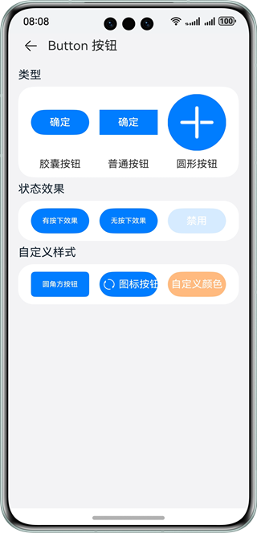
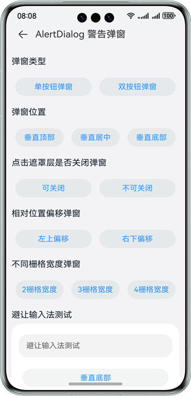
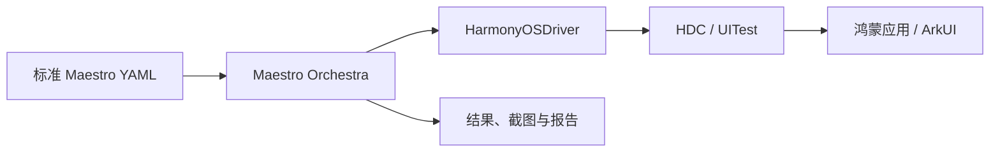

# Maestro HarmonyOS

**用标准 Maestro YAML 编写鸿蒙应用的界面自动化测试。** 在电脑上连接设备，查找控件、点击、输入、滑动和检查结果，保存截图与运行报告。应用改版后可以重复执行同一个 Flow，检查原有操作是否仍然正常。

工具运行在开发或测试电脑上，测试应用需提前安装，无需引入 ArkTS/HAR 运行依赖。本项目是独立社区适配项目，与 Maestro 上游及操作系统厂商不存在官方隶属关系。

## 背景与用途

Hypium、hmdriver2 等工具提供了代码式的鸿蒙 UI 测试能力。维护页面回归用例时，团队还需要组织测试代码、等待条件、失败处理和公共流程。已有其他移动平台用例的团队，也需要处理测试体系之间的迁移与复用。

本项目在 Maestro 中补充 `HarmonyOSDriver` 和 CLI 会话，沿用原有 YAML 解析、Flow 编排与报告。常见操作可以直接写成可读的测试步骤，通过子 Flow、参数、条件分支和显式 `retry` 组织用例，再从命令行或 CI 调用。跨平台可以复用用例组织方式，控件标识、应用配置及平台命令仍需按目标应用调整。

## 官方示例

新增 [HMOS 代码工坊](examples/hmos-code-lab/README.md)的固定版本获取入口。它来自华为 [HarmonyOS_Samples/sample_in_harmonyos](https://gitcode.com/HarmonyOS_Samples/sample_in_harmonyos)，手机和平板使用同一个 `phone` 模块；本仓补充前台常亮和 Maestro Flow。

```powershell
node examples/hmos-code-lab/prepare.mjs
```

脚本把完整工程准备到 `examples/hmos-code-lab/app`。用 DevEco 打开该目录，为自己的设备配置调试签名并运行，再按[单页用例说明](examples/hmos-code-lab/flows/README.md)执行。固定源码要求兼容 API 23、目标 API 24；源码下载约 360 MB，工程和本机签名配置均由 Git 忽略。无需下载其全部外部 Sample。

| 示例 | 用途与状态 |
| --- | --- |
| [HMOS 代码工坊](examples/hmos-code-lab/README.md) | 获取完整官方工程，提供按钮、输入、弹窗候选 Flow；真机适配待验证。 |
| [ComponentCollection](examples/component-collection/README.md) | 已有按钮、输入、弹窗、滚动用例及手机、平板的开发验证记录；运行前需自行准备应用。 |

### 页面预览

下面是 ComponentCollection 上游项目的原始配图，展示按钮和弹窗的测试页面。[来源与许可证](docs/images/README.md)、[实际运行记录](examples/component-collection/README.md#单机开发预跑)分别记录。

| Button 按钮 | AlertDialog 警告弹窗示例页 |
| --- | --- |
|  |  |

## 跑一个 Flow

先按[使用指南](docs/user-guide.md)准备 JDK 17、Node.js 22.12+、HDC，并从固定上游和本仓补丁构建 CLI。普通 Maestro 安装包不能替代这个适配版本；VSCode 插件需单独构建，也不包含 Java、HDC 或 CLI。资源下载和缓存配置见[构建说明](docs/build-reproducibility.md)。

以 [ComponentCollection 前台按钮用例](examples/component-collection/foreground/01-buttons.yaml)为例：应用已构建、签名并安装后，手动进入 **Button 按钮**页，保持应用前台、设备解锁，且胶囊按钮尚未点击。Flow 通过控件 ID 点击，并检查点击后的 ID：

```yaml
appId: ohos.samples.componentcollection
---
- assertVisible:
    id: Capsule
- tapOn:
    id: Capsule
    retryTapIfNoChange: false
- assertVisible:
    id: Capsule onClickId
- takeScreenshot: foreground-button
```

在仓库根目录执行，将 `YOUR_DEVICE_ID` 替换为 HDC 设备标识：

```powershell
$env:MAESTRO_HARMONYOS_RECORDING = 'off'
./scripts/run-harmonyos.ps1 `
  -FlowPath ./examples/component-collection/foreground/01-buttons.yaml `
  -BundleId ohos.samples.componentcollection -AbilityName MainAbility -Module entry `
  -DeviceId YOUR_DEVICE_ID -RunTimeoutSeconds 360
```

此用例停留在当前页面，适合依靠应用前台常亮的设备。再次运行前需恢复按钮初始状态；[前台单页用例](examples/component-collection/foreground/README.md)各有不同起始页面，一次只运行一个文件。需要自动导航和批量执行时，使用[完整场景入口](examples/component-collection/README.md)，按其要求准备应用。

测试自己的应用可从参数化的 [smoke.yaml](examples/flows/smoke.yaml)、[input-smoke.yaml](examples/flows/input-smoke.yaml)和 [scroll-input.yaml](examples/flows/scroll-input.yaml)开始。runner 保存独立产物目录和真实退出码；结果与排错方法见[使用指南](docs/user-guide.md)。

## 实现方式



Maestro 负责解析、编排、等待和断言；适配层将 UITest 布局映射为 Maestro 节点，用文本、ID 等选择器定位控件，再调用设备操作。会话记录命令与临时资源的清理状态；无法确认释放时保留 `unknown` 并阻止接管，恢复不会改写原用例结果。

Kotlin 实现采用固定上游加补丁的交付方式；VSCode 扩展、运行脚本和客户端示例直接保存在本仓。上游版本见 [upstream.lock.json](upstream.lock.json)，模块职责与执行过程见[开发设计](docs/development-design.md)，更新实现的方法见[补丁说明](patches/maestro/README.md)。

## Agent 接入

[Node.js 客户端](examples/agent-client/README.md)通过本地 JSONL 协议查询环境、执行动作、校验结果与证据，并确认设备释放。下面的调用检查当前页面文字并截图；先手动打开测试页面，替换设备、应用和断言内容：

```powershell
node examples/agent-client/run.mjs `
  --device 'YOUR_DEVICE_ID' `
  --app 'org.example.demo' --ability 'EntryAbility' `
  --assert-text '替换为页面上的确定文字' `
  --artifacts './artifacts/agent-example'
```

默认使用本仓构建的 CLI；其他分发位置通过 `--cli-dir` 指定包含 `lib` 的目录。示例默认不启动应用，预检存在未知项时会停止。完整 YAML 可在设备释放后通过 `--handoff-flow` 交给 CLI；没有设备时先运行 [`--check-only` 检查](examples/agent-client/README.md#释放后运行-yaml)。协议字段见[调用协议](docs/agent-protocol.md)，换电脑联调见[便携包说明](docs/agent-bundle.md)。

## 能力与边界

| 能力 | 当前范围 |
| --- | --- |
| YAML 与 ArkUI 操作 | 支持 `tapOn`、输入、滑动、可见性断言、截图及 Flow 编排；具体命令见[已实现与限制](docs/setup.md#已实现与限制)。自绘界面或不可识别节点需单独验证。 |
| 报告与 CI | 支持 Flow/目录执行、Maestro 结果、JUnit 报告和 Windows CI 入口；实际 CI 服务平台尚未接入。首次与重试后的最终结果分别记录。 |
| VSCode 辅助编写 | 提供代码片段、截图与控件树选择、动作执行、YAML 生成和回放；记录插件发出的动作，不监听手机手工触摸。 |
| 视频与会话恢复 | 视频录屏默认关闭，Huawei 系统录屏仍为实验功能；历史尾部解码问题和启动未确认资源的恢复仍待解决。清理恢复按证据判定，不能删除占用标记绕过。 |

每个 CLI 会话操作一台本机 HDC 设备，[逐台验证脚本](docs/device-matrix.md)依次建立会话。目前不提供 HAP 安装、权限修改、清除应用数据、Studio/MCP、多设备分片或云端运行。

源码 `1c13d22` 已完成主机回归、复用已声明依赖缓存的独立 CLI/VSIX 构建，以及便携包的 `version`、`describe`、`check-only` 检查。这些检查未操作设备，不是全冷构建或真机通过证明。此前已有手机和平板上的页面操作、录制回放及会话恢复记录，但来自不同构建；固定版本 20 轮稳定性验证尚未完成，不能合并历史记录计算通过率。

详细范围见[测试计划与记录](docs/acceptance.md)、[重复验证计划](docs/validation-plan.md)、[手机批量与录屏记录](docs/progress/2026-11-01.md)和[平板验证记录](docs/progress/2026-11-01-tablet.md)。

## 文档与贡献

- 开始使用：[使用指南](docs/user-guide.md) · [环境与运行参数](docs/setup.md) · [HMOS 代码工坊](examples/hmos-code-lab/README.md) · [ComponentCollection 场景](examples/component-collection/README.md)
- 编写与接入：[VSCode 插件](packages/vscode/README.md) · [Agent 客户端](examples/agent-client/README.md) · [便携联调包](docs/agent-bundle.md)
- 开发与维护：[开发设计](docs/development-design.md) · [贡献说明](CONTRIBUTING.md) · [主机测试](host-tests/README.md) · [第三方来源](THIRD_PARTY.md)

<details>
<summary>运行、协议及历史验证参考</summary>

- 执行：[逐台验证](docs/device-matrix.md) · [CI 入口与设备占用](docs/ci.md) · [构建复现](docs/build-reproducibility.md)
- 协议：[Agent 协议](docs/agent-protocol.md) · [录制桥接协议](docs/recorder-protocol.md) · [磁盘文件格式与 Schema](docs/protocol/README.md)
- 恢复：[录屏检查与恢复](docs/recording-diagnostics.md) · [顺序重启维护](docs/session-maintenance.md) · [不重启的清理隔离恢复](docs/cleanup-fence-recovery.md)
- 记录：[10-28](docs/progress/2026-10-28.md) · [10-29](docs/progress/2026-10-29.md) · [10-30](docs/progress/2026-10-30.md) · [10-30 补验](docs/progress/2026-10-30-followup.md) · [阶段说明](docs/progress/2026-10-30-stage.md)

</details>

## 许可证

本仓新增内容采用 [Apache-2.0](LICENSE)。引入内容保留原许可证、版权声明及适用的 NOTICE；文档图片的来源见[图片说明](docs/images/README.md)。
