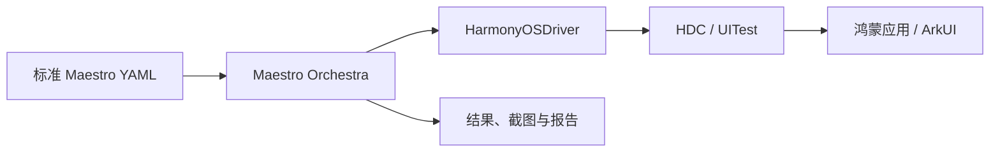

# Maestro HarmonyOS

**用标准 Maestro YAML 编写鸿蒙应用的界面自动化测试。** 在电脑上连接设备，查找控件、点击、输入、滑动和检查结果，保存截图与运行报告。应用改版后可以重复执行同一个 Flow，检查原有操作是否仍然正常。

工具运行在开发或测试电脑上，测试应用需提前安装，无需引入 ArkTS/HAR 运行依赖。本项目是独立社区适配项目，与 Maestro 上游及操作系统厂商不存在官方隶属关系。

**让 Agent 调用测试：[鸿测 Agent 开源仓库](https://gitcode.com/HarmonyPandaWorkshop/hongce-agent)。** 鸿测基于本项目提供 MCP、CLI 和 HTTP 接口，负责提交回归任务、查询执行状态和交付 HTML 报告。接入方式见下方 [Agent 接入](#agent-接入)。

## 交付进度

- **交付时间：** 具备交付条件后提前提交，最晚 2026 年 12 月 23 日。
- **当前进度：** 约 90%（更新于 2026 年 11 月 5 日 10:06，北京时间，按完整场景套件的交付准备度估算）。

Maestro 鸿蒙适配、YAML 执行、重试与报告、VSCode 辅助工具和通用 CI 入口已实现。当前版本的 HMOS 完整组件套件在同一台真机上 **20/20 轮首次通过，通过率 100%**；未使用 YAML 重试，人工干预、固定输入和执行证据均已复核，所有轮次正常清理。

[完整场景套件](examples/hmos-code-lab/flows/suite/README.md)串联中文输入、按钮样式、弹窗及回程导航。此前 ComponentCollection 前台单 Flow 和 HMOS 按钮样式单 Flow 的 20/20 结果单独保留；手机和平板的输入、弹窗开发验证也不与本次完整套件混算。

| 项目 | 状态 | 验证依据 |
| --- | --- | --- |
| 导航修复及完整场景单轮 | **通过** | 按钮定向回归 3 分 36 秒、完整单轮 12 分 51 秒；未使用重试，CLI 与 runner 退出码均为 0，`cleanup=complete` |
| HDC 诊断及最终清理核验 | **单轮与 20 轮收尾通过** | 501 项 JVM 回归通过；真机 20 轮清理完成，设备最终释放；23,114 次 HDC 调用日志已核对，本批未复现此前约 5 秒的超时故障 |
| 完整场景分段录屏 | **此前版本通过一次完整运行** | `728859cb` CLI 执行 12 分 55 秒，输入、按钮、弹窗三段原片均完整解码通过，清理完成 |
| 交付文件与插件回放 | **新交付包主机核验通过** | `2d5bfaeb` 独立构建 CLI、VSIX 0.1.1 和便携包；450 个文件核验、三项便携包自测及 24 项插件测试通过。此前 `728859cb` 的真实 VSCode 保存回放记录保留，本次打包未重新操作设备 |
| 完整套件 20 轮稳定性 | **通过** | 11 月 5 日固定版本完整套件 20/20 轮首次通过，100%；未使用 YAML 重试、无人工干预或环境变化，清理全部完成，证据复核通过 |

旧版 20 轮的四次失败均发生在顶部标题栏覆盖的按钮入口，20 轮清理均完成，执行期间无人工操作、重装或重启。当前修复针对示例页面，不提供通用遮挡检测；原始结果分别保留，详见[导航修复记录](docs/progress/2026-11-04-hmos-navigation.md)及[历史稳定性记录](docs/progress/2026-11-03-hmos-stability.md)。

长场景录屏留证和真实 VSCode 回放已有[验证记录](docs/progress/2026-11-04-delivery.md)，完整套件 20 轮结果及 HDC 日志结论见[本轮记录](docs/progress/2026-11-05-hdc-cleanup.md#完整套件-20-轮)。当前源码的 CLI、VSIX 和便携包已重新构建、核验并生成校验值，见 [v0.1.1 交付说明](docs/releases/0.1.1.md)；GitCode 发行版附件待上传。后续重点是接入实际 CI 平台，配置可连接真机的 Windows runner，完成任务执行、取消收尾和报告归档联调。20 轮批次录屏关闭，不将它记为录屏重复验证。

## 背景与用途

Hypium、hmdriver2 等工具提供了代码式的鸿蒙 UI 测试能力。维护页面回归用例时，团队还需要组织测试代码、等待条件、失败处理和公共流程。已有其他移动平台用例的团队，也需要处理测试体系之间的迁移与复用。

本项目在 Maestro 中补充 `HarmonyOSDriver` 和 CLI 会话，沿用原有 YAML 解析、Flow 编排与报告。常见操作可以直接写成可读的测试步骤，通过子 Flow、参数、条件分支和显式 `retry` 组织用例，再从命令行或 CI 调用。跨平台可以复用用例组织方式，控件标识、应用配置及平台命令仍需按目标应用调整。

## 官方示例

新增 [HMOS 代码工坊](examples/hmos-code-lab/README.md)的固定版本获取入口。它来自华为 [HarmonyOS_Samples/sample_in_harmonyos](https://gitcode.com/HarmonyOS_Samples/sample_in_harmonyos)，手机和平板使用同一个 `phone` 模块；本仓补充前台常亮和 Maestro Flow。

```powershell
node examples/hmos-code-lab/prepare.mjs
```

脚本把完整工程准备到 `examples/hmos-code-lab/app`。用 DevEco 打开该目录，为自己的设备配置调试签名并运行，再按[单页用例说明](examples/hmos-code-lab/flows/README.md)执行。固定源码要求兼容 API 23、目标 API 24；源码下载约 360 MB，工程和本机签名配置均由 Git 忽略。无需下载其全部外部 Sample。

| 示例 | 用途与状态 |
| --- | --- |
| [HMOS 代码工坊](examples/hmos-code-lab/README.md) | 获取完整官方工程；输入和弹窗 Flow 已在手机与 API 26 平板各通过一次。原按钮 Flow 在两台设备上均未通过短暂 Toast 断言；按钮样式单 Flow 在手机固定版本 20/20 轮首次通过。11 月 5 日，输入、按钮、弹窗及回程导航组成的完整套件在手机上固定版本 20/20 轮首次通过，见[本轮记录](docs/progress/2026-11-05-hdc-cleanup.md#完整套件-20-轮)。旧失败批次分别保留，另见[平板记录](docs/progress/2026-11-03-hmos.md)与[历史稳定性记录](docs/progress/2026-11-03-hmos-stability.md)。 |
| [ComponentCollection](examples/component-collection/README.md) | 已有按钮、输入、弹窗、滚动用例及手机、平板的开发验证记录；手机前台单 Flow 连续 20/20 轮通过。运行前需自行准备应用。 |

### 页面预览

下面是 2026-11-03 在平板运行 HMOS 输入和弹窗 Flow 时保存的原始截图。测试条件与结果见[验证记录](docs/progress/2026-11-03-hmos.md)，图片来源见[图片说明](docs/images/README.md)。

| TextInput 输入验证 | AlertDialog 弹窗验证 |
| --- | --- |
|  |  |

## 跑一个 Flow

先按[使用指南](docs/user-guide.md)准备 JDK 17、Node.js 22.12+ 和 HDC。[v0.1.1 交付说明](docs/releases/0.1.1.md)列出 CLI、VSIX、便携包及校验方法；也可从固定上游和本仓补丁构建 CLI。普通 Maestro 安装包不能替代这个适配版本，插件不包含 Java、HDC 或 CLI。资源下载和缓存配置见[构建说明](docs/build-reproducibility.md)。

使用便携包时，在解压后的 `source` 目录执行下列脚本，并加上 `-CliDir ../cli`，无需重新编译 CLI。源码检出并构建的用户使用脚本默认路径即可。当前发行版附件尚待上传，文件可用状态见交付说明。

以 [ComponentCollection 前台按钮用例](examples/component-collection/foreground/01-buttons.yaml)为例：应用已构建、签名并安装后，手动进入 **Button 按钮**页，保持应用前台、设备解锁，且胶囊按钮尚未点击。Flow 通过控件 ID 点击，并检查点击后的 ID：

```yaml
appId: ohos.samples.componentcollection
---
- assertVisible:
    id: Capsule
- tapOn:
    id: Capsule
    retryTapIfNoChange: false
- assertVisible:
    id: Capsule onClickId
- takeScreenshot: foreground-button
```

在仓库根目录执行，将 `YOUR_DEVICE_ID` 替换为 HDC 设备标识：

```powershell
$env:MAESTRO_HARMONYOS_RECORDING = 'off'
./scripts/run-harmonyos.ps1 `
  -FlowPath ./examples/component-collection/foreground/01-buttons.yaml `
  -BundleId ohos.samples.componentcollection -AbilityName MainAbility -Module entry `
  -DeviceId YOUR_DEVICE_ID -RunTimeoutSeconds 360
```

此用例停留在当前页面，适合依靠应用前台常亮的设备。再次运行前需恢复按钮初始状态；[前台单页用例](examples/component-collection/foreground/README.md)各有不同起始页面，一次只运行一个文件。需要自动导航和批量执行时，使用[完整场景入口](examples/component-collection/README.md)，按其要求准备应用。

测试自己的应用可从参数化的 [smoke.yaml](examples/flows/smoke.yaml)、[input-smoke.yaml](examples/flows/input-smoke.yaml)和 [scroll-input.yaml](examples/flows/scroll-input.yaml)开始。runner 保存独立产物目录和真实退出码；结果与排错方法见[使用指南](docs/user-guide.md)。

## 实现方式



Maestro 负责解析、编排、等待和断言；适配层将 UITest 布局映射为 Maestro 节点，用文本、ID 等选择器定位控件，再调用设备操作。会话记录命令与临时资源的清理状态；无法确认释放时保留 `unknown` 并阻止接管，恢复不会改写原用例结果。

Kotlin 实现采用固定上游加补丁的交付方式；VSCode 扩展、运行脚本和客户端示例直接保存在本仓。上游版本见 [upstream.lock.json](upstream.lock.json)，模块职责与执行过程见[开发设计](docs/development-design.md)，更新实现的方法见[补丁说明](patches/maestro/README.md)。

## Agent 接入

### 通过鸿测 Agent 提交回归任务

**开源地址：[https://gitcode.com/HarmonyPandaWorkshop/hongce-agent](https://gitcode.com/HarmonyPandaWorkshop/hongce-agent)**

需要让 Agent 执行已有 YAML 并交付报告时，可使用鸿测 Agent。它将本项目的 CLI 封装为独立 worker，提供任务提交、请求去重、状态查询、证据核验和 JSON/HTML 报告。Maestro HarmonyOS 负责实际设备操作与会话清理；上层 Agent 按宿主能力选择 MCP、CLI 或 HTTP，调用同一个 worker。

1. 按本仓[使用指南](docs/user-guide.md)准备 CLI、Java、HDC 和已安装的目标应用，先跑通所需 Flow。
2. 按[鸿测 README](https://gitcode.com/HarmonyPandaWorkshop/hongce-agent/blob/main/README.md)部署 worker，在本地 JSON 配置中绑定设备、实际 CLI 分发包及其指纹，并登记应用和 Flow。配置模板见 [device-config.example.json](https://gitcode.com/HarmonyPandaWorkshop/hongce-agent/blob/main/device-config.example.json)。鸿测通过 `HONGCE_MAESTRO_CONFIG` 读取此 JSON，本仓的 `config.local.ps1` 仅配置底层工具路径。
3. 将鸿测的通用回归 Skill 和所选协议入口接到 Agent，按已登记的用例提交任务，保存 `request_id` / `run_id`，查询终态并读取报告。完整配置与调用示例见[鸿测真机执行指南](https://gitcode.com/HarmonyPandaWorkshop/hongce-agent/blob/main/docs/worker-device-execution.md)。

配置完成后，可以对 Agent 说：“执行这个应用已登记的冒烟回归，结束后给我 HTML 报告，说明失败、阻塞和未执行项。”鸿测当前执行已登记的 YAML，真实用例不自动修改或重放；现有执行器关闭录屏，`cleanup=unknown` 不会算作通过。完整套件的首次通过率与录屏验证仍按本仓[验证计划](docs/validation-plan.md)执行。

### 直接接入底层协议

[Node.js 客户端](examples/agent-client/README.md)通过本地 JSONL 协议查询环境、执行动作、校验结果与证据，并确认设备释放。下面的调用检查当前页面文字并截图；先手动打开测试页面，替换设备、应用和断言内容：

```powershell
node examples/agent-client/run.mjs `
  --device 'YOUR_DEVICE_ID' `
  --app 'org.example.demo' --ability 'EntryAbility' `
  --assert-text '替换为页面上的确定文字' `
  --artifacts './artifacts/agent-example'
```

默认使用本仓构建的 CLI；其他分发位置通过 `--cli-dir` 指定包含 `lib` 的目录。示例默认不启动应用，预检存在未知项时会停止。完整 YAML 可在设备释放后通过 `--handoff-flow` 交给 CLI；没有设备时先运行 [`--check-only` 检查](examples/agent-client/README.md#释放后运行-yaml)。协议字段见[调用协议](docs/agent-protocol.md)，换电脑联调见[便携包说明](docs/agent-bundle.md)。

## 能力与边界

| 能力 | 当前范围 |
| --- | --- |
| YAML 与 ArkUI 操作 | 支持 `tapOn`、输入、滑动、可见性断言、截图及 Flow 编排；具体命令见[已实现与限制](docs/setup.md#已实现与限制)。自绘界面或不可识别节点需单独验证。 |
| 报告与 CI | 支持 Flow/目录执行、Maestro 结果、JUnit 报告和 Windows CI 入口；实际 CI 服务平台尚未接入。首次与重试后的最终结果分别记录。 |
| VSCode 辅助编写 | 提供代码片段、截图与控件树选择、动作执行、YAML 生成和回放；记录插件发出的动作，不监听手机手工触摸。 |
| 视频与会话恢复 | 视频录屏默认关闭，Huawei 系统录屏仍为实验功能；完整场景三段原片均完整解码通过。长场景可使用[分段入口](examples/hmos-code-lab/flows/recorded-suite/README.md)。已确认锁屏拒绝、且未产生采集与媒体的旧资源可受控恢复；其他未知状态仍须逐案核查。 |

每个 CLI 会话操作一台本机 HDC 设备，[逐台验证脚本](docs/device-matrix.md)依次建立会话。目前本仓不提供 HAP 安装、权限修改、清除应用数据、Studio、内置 MCP 服务、多设备分片或云端运行；面向 Agent 的 MCP 服务由上述鸿测项目提供。

当前交付文件来自源码 `2d5bfaeb`，在独立目录构建，显式复用依赖缓存及经校验的 simulator 资源，没有复制旧编译产物。便携包的 `version`、`describe`、`check-only` 检查通过。新 CLI 与 20 轮所用分发包的类文件和其他资源一致，仅 JAR 封装元数据及版本文件的生成时间注释不同；本次打包未重新执行真机测试，已有结果保留原产物身份。版本与摘要见[交付说明](docs/releases/0.1.1.md)，构建过程见[构建记录](docs/build-reproducibility.md)。后续文档提交不改变这些安装包的源码标识。

详细范围见[测试计划与记录](docs/acceptance.md)、[重复验证计划](docs/validation-plan.md)、[最新手机记录](docs/progress/2026-11-03-phone.md)和[平板验证记录](docs/progress/2026-11-01-tablet.md)。

## 文档与贡献

- 开始使用：[使用指南](docs/user-guide.md) · [环境与运行参数](docs/setup.md) · [HMOS 代码工坊](examples/hmos-code-lab/README.md) · [ComponentCollection 场景](examples/component-collection/README.md)
- 编写与接入：[VSCode 插件](packages/vscode/README.md) · [鸿测 Agent 开源仓库](https://gitcode.com/HarmonyPandaWorkshop/hongce-agent) · [Agent 客户端](examples/agent-client/README.md) · [便携联调包](docs/agent-bundle.md)
- 开发与维护：[开发设计](docs/development-design.md) · [贡献说明](CONTRIBUTING.md) · [主机测试](host-tests/README.md) · [第三方来源](THIRD_PARTY.md)

<details>
<summary>运行、协议及历史验证参考</summary>

- 执行：[逐台验证](docs/device-matrix.md) · [CI 入口与设备占用](docs/ci.md) · [构建复现](docs/build-reproducibility.md)
- 协议：[Agent 协议](docs/agent-protocol.md) · [录制桥接协议](docs/recorder-protocol.md) · [磁盘文件格式与 Schema](docs/protocol/README.md)
- 恢复：[录屏检查与恢复](docs/recording-diagnostics.md) · [顺序重启维护](docs/session-maintenance.md) · [不重启的清理隔离恢复](docs/cleanup-fence-recovery.md)
- 记录：[10-28](docs/progress/2026-10-28.md) · [10-29](docs/progress/2026-10-29.md) · [10-30](docs/progress/2026-10-30.md) · [10-30 补验](docs/progress/2026-10-30-followup.md) · [阶段说明](docs/progress/2026-10-30-stage.md)

</details>

## 许可证

本仓新增内容采用 [Apache-2.0](LICENSE)。引入内容保留原许可证、版权声明及适用的 NOTICE；文档图片的来源见[图片说明](docs/images/README.md)。
