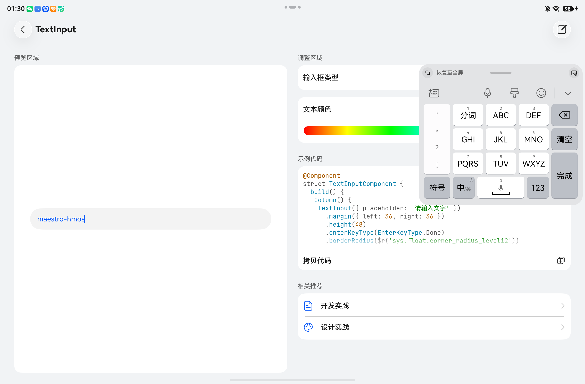
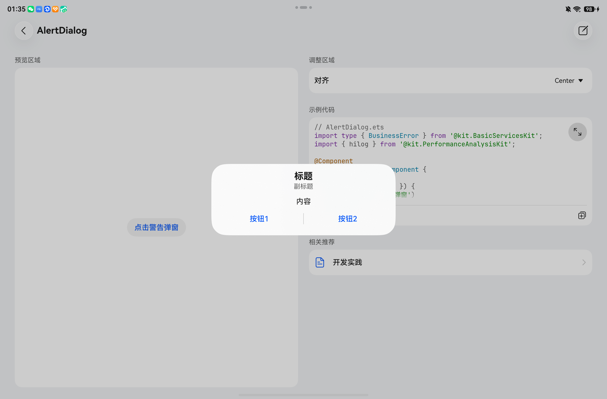
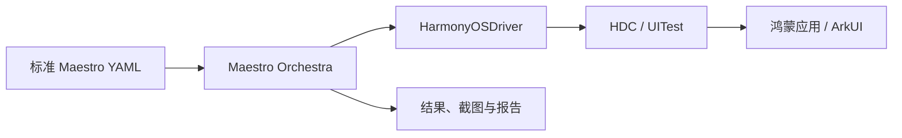

# Maestro HarmonyOS

[演示入口](docs/demo.md) · [v0.1.4 发行说明](docs/releases/0.1.4.md) · [AtomGit 发行页](https://atomgit.com/HarmonyPandaWorkshop/maestro-harmonyos/releases)

**v0.1.4 已发布。** 新增 `hideKeyboard`、VS Code 命令补全和 Agent 预检支持，修复启动时的窗口焦点判断。后台预览和主机录屏共用缩小帧，显式截图仍保存原尺寸。API 22 模拟器的静态页面短测中，预览单帧数据量减少约 **80.3%**。

本版累计通过 **1,269 项** TAP/JUnit 检查。API 22 模拟器的 ComponentCollection 五条 Flow **5/5 通过，用时 4 分 7 秒**。解压后的 CLI 已验证故意失败、截图留证、释放设备和重跑，实际安装的 VS Code 插件 0.1.3 已验证预览与录屏。 [Windows CI](https://github.com/GeorgeGcs/maestro-harmonyos/actions/runs/44548088023)

**用标准 Maestro YAML 编写鸿蒙应用的界面自动化测试。** 在电脑上连接设备，查找控件、点击、输入、滑动和检查结果，保存截图与运行报告。应用改版后可以重复执行同一个 Flow，检查原有操作是否仍然正常。

工具运行在开发或测试电脑上，测试应用需提前安装，无需引入 ArkTS/HAR 运行依赖。本项目是独立社区适配项目，与 Maestro 上游及操作系统厂商不存在官方隶属关系。

**让 Agent 调用测试：[鸿测 Agent 开源仓库](https://atomgit.com/HarmonyPandaWorkshop/hongce-agent)。** 鸿测基于本项目提供 MCP、CLI 和 HTTP 接口，负责提交回归任务、查询执行状态和交付 HTML 报告。接入方式见下方 [Agent 接入](#agent-接入)。

**下载 v0.1.4** 的便携包、独立 Windows CLI 或 VS Code 插件 0.1.3。下载后按 `SHA256SUMS` 校验文件，附件所用源码提交见 `release-manifest.json`。 [AtomGit 发行页](https://atomgit.com/HarmonyPandaWorkshop/maestro-harmonyos/releases) · [安装说明](docs/releases/0.1.4.md#安装)

## 交付进度

- **交付时间：** 具备交付条件后提前提交，最晚 2026 年 12 月 23 日。
- **当前进度**为 **100%**（更新于 2026 年 11 月 24 日 15:42，北京时间）。课题交付材料已完成，v0.1.4 的发行附件已上传。发行后合入的源码变更见[最新回归](#11-月-24-日源码回归)。

Maestro 鸿蒙适配、YAML 执行、重试与报告、VSCode 辅助工具和通用 CI 入口已实现。手机固定版本的 HMOS 完整组件套件在同一台真机上 **20/20 轮首次通过，通过率 100%**；未使用 YAML 重试，人工干预、固定输入和执行证据均已复核，所有轮次正常清理。后续修复及平板验证单独记录，不替换这份版本基线。

[完整场景套件](examples/hmos-code-lab/flows/suite/README.md)串联中文输入、按钮样式、弹窗及回程导航。此前 ComponentCollection 前台单 Flow 和 HMOS 按钮样式单 Flow 的 20/20 结果单独保留；手机和平板的输入、弹窗开发验证也不与本次完整套件混算。

| 项目 | 状态 | 验证依据 |
| --- | --- | --- |
| 导航修复及完整场景单轮 | **通过** | 按钮定向回归 3 分 36 秒、完整单轮 12 分 51 秒；未使用重试，CLI 与 runner 退出码均为 0，`cleanup=complete` |
| HDC 诊断及最终清理核验 | **单轮与 20 轮收尾通过** | 501 项 JVM 回归通过；真机 20 轮清理完成，设备最终释放；23,114 次 HDC 调用日志已核对，本批未复现此前约 5 秒的超时故障 |
| 完整场景分段录屏 | **此前版本通过一次完整运行** | `728859cb` CLI 执行 12 分 55 秒，输入、按钮、弹窗三段原片均完整解码通过，清理完成 |
| 交付文件与插件回放 | **v0.1.4 主机回归与模拟器验证通过** | 1,269 项 TAP/JUnit 检查通过。API 22 模拟器 5/5 通过，耗时 4 分 7 秒。实际发行包完成失败留证、设备释放及重跑验证，实际安装插件完成预览和录屏。见[发行说明](docs/releases/0.1.4.md#验证) |
| 手机完整套件 20 轮稳定性 | **通过** | 11 月 5 日 01:20:50～05:38:24，20 轮耗时 **4 小时 17 分 34 秒**，单轮平均约 **12 分 52 秒**；固定版本 20/20 首次通过，100%，无重试、无人工干预，清理及证据复核通过 |
| HarmonyOS 7 平板补充验证 | **v0.1.2 完整套件 20/20 首次通过** | 11 月 5 日 20:30～23:59，约 **3 小时 29 分钟**；无重试、无人工干预，20 轮清理完成、设备正常释放。15,673 次已归档 HDC 调用无失败，见[平板记录](docs/progress/2026-11-06-tablet-v012.md)；旧失败批次保留 |

旧版 20 轮的四次失败均发生在顶部标题栏覆盖的按钮入口，20 轮清理均完成，执行期间无人工操作、重装或重启。当前修复针对示例页面，不提供通用遮挡检测；原始结果分别保留，详见[导航修复记录](docs/progress/2026-11-04-hmos-navigation.md)及[历史稳定性记录](docs/progress/2026-11-03-hmos-stability.md)。

长场景录屏留证和真实 VSCode 回放已有[验证记录](docs/progress/2026-11-04-delivery.md)。手机完整套件 20 轮结果见[手机记录](docs/progress/2026-11-05-hdc-cleanup.md#完整套件-20-轮)；平板新版本的 20 轮、人工干预复核及耗时见[平板记录](docs/progress/2026-11-06-tablet-v012.md)，两批分别统计。包含查询超时和长会话恢复修复的 [v0.1.2](docs/releases/0.1.2.md)已发布，实际 CLI 冒烟与平板长测均通过。GitHub Windows 主机构建已接入。远端真机派发、更多设备和 OpenHarmony 真机属于后续补充验证。20 轮批次录屏关闭，不将它记为录屏重复验证。

**测试时间成本：** 手机与平板分别执行完整场景套件，实测如下。

| 设备与记录 | 完整套件 20 轮耗时 | 单轮平均耗时 | 首次通过 |
| --- | --- | --- | --- |
| [手机](docs/progress/2026-11-05-hdc-cleanup.md#完整套件-20-轮) | **4 小时 17 分 34 秒** | 约 **12 分 52 秒** | **20/20，100%** |
| [平板](docs/progress/2026-11-06-tablet-v012.md) | 约 **3 小时 29 分钟** | 约 **10 分 25 秒** | **20/20，100%** |

耗时包含逐轮启动、执行和清理。两批分别保留各自的固定版本与设备环境，其他环境耗时会变化；上述数据不作为不同设备的性能对比。批次由脚本独立执行，两批均无重试、无人工干预，全部正常清理并释放设备。

## 取树性能、失败定位和设备恢复

| 项目 | 已验证的结果 |
| --- | --- |
| RPC 取树 | 在同一台 HarmonyOS 7 平板上，用同一份 CLI 对 HMOS 代码工坊完整套件做了一组对照。默认 HDC **9 分 33 秒**，RPC **6 分 03 秒**，端到端耗时缩短 **36.6%**（约 **3 分 29 秒**）。两轮均通过，**98 条步骤结果逐条一致**，设备均已释放。见[验证范围与使用条件](docs/development-design.md#rpc-取树)。 |
| VS Code 运行与失败定位 | 运行中高亮 YAML 并显示子 Flow 状态。点击失败步骤可在同一区域查看失败行、截图和日志摘要，平板已验证停止、确认释放和重跑。见[插件说明](packages/vscode/README.md#看运行进度停止与重跑)及[真机验收记录](docs/progress/2026-11-14-vscode-live-run.md)。 |
| VS Code 触摸录制与语法检查 | 点击优先生成控件 ID 或文本。插件用录制前的控件树核对首个点击，重复匹配时尝试用唯一父容器生成 `childOf`。同一条文本选择器已从平板录制并在手机回放通过。源码版插件已在真实 VS Code 中验证常用命令和参数补全，以及保存后定位 Maestro 语法错误，无需连接设备。见[录制与检查说明](packages/vscode/README.md#在-vs-code-里录制真机触摸)。 |
| CI 与设备收尾 | 通用 Windows CI 已从干净源码构建 CLI、自动启动 API 22 模拟器、安装 HAP 并执行 Flow。已归档 JUnit 和截图，确认会话释放、模拟器关闭。见[流程与证据](docs/ci.md)。 |
| Agent 接入 | 鸿测通过 MCP、HTTP 或 CLI 提交已登记的回归用例，由独立 worker 执行并交付 HTML 报告。同一接口也接入了 Android、iOS 和 Web，各平台的验证范围见[鸿测仓库](https://atomgit.com/HarmonyPandaWorkshop/hongce-agent)。 |

### API 26 真机性能

2026 年 11 月 15 日在同一台 HUAWEI Mate 60 Pro（HarmonyOS 7.0.0.111 / API 26）上分阶段测试。各阶段在同一场景中使用相同的 HAP 和 YAML。表中为通过轮次的耗时中位数，原生数据排除预热。CLI 总耗时从进程启动算到退出，Flow 内耗时从启动应用算到显式截图完成。

| 原生冒烟阶段 | 通过轮次 | CLI 总耗时 | Flow 内耗时 | `tapOn` |
| --- | ---: | ---: | ---: | ---: |
| 初始 HDC 实现 | 10/10 | 34.60 秒 | 23.12 秒 | 13.87 秒 |
| 独立尺寸查询、短时复用组件树 | 4/4 | 26.42 秒 | 16.25 秒 | 9.54 秒 |
| RPC 取树 | 2/2 | 12.54 秒 | 5.49 秒 | 2.01 秒 |
| RPC 取树和尺寸查询 | 2/2 | **9.68 秒** | **3.94 秒** | **1.29 秒** |

| ArkWeb 滚动阶段 | 通过轮次 | CLI 总耗时 | 滚动步骤 |
| --- | ---: | ---: | ---: |
| 初始 HDC 实现 | 1/1 | 80.49 秒 | 45.39 秒 |
| 独立尺寸查询、减少重复取树 | 2/2 | 41.30 秒 | 20.32 秒 |
| RPC 取树、复用 ArkWeb 页面连接 | 2/2 | 20.07 秒 | 8.41 秒 |
| RPC 取树和尺寸查询、复用页面连接 | 2/2 | **14.59 秒** | **5.98 秒** |

各阶段的显式截图均成功保存。最终构建的四轮均使用 RPC 取树和查询尺寸，ArkWeb 测试结束后恢复了原 HAP 并移除了转发。以上为源码构建的短用例数据，完整套件的稳定性记录见前文。

测试设备已有受支持的 UITest 服务时，CLI 能自动建立并回收本次 RPC 转发。也可以显式指定转发，连接或读取失败时由 HDC 继续取树。[就绪检查、测试入口和实际取树日志](docs/setup.md#检查和准备-rpc)

### 11 月 26 日真机 ArkWeb CSS 回归

在同一台 API 26 手机上运行 ComponentCollection 双 WebView 样例。Flow 在第二个 WebView 中按 CSS 读取计数、检查第一个 WebView 的输入框未被选中、点击按钮、核对计数变化并截图。

| 原生取树方式 | 首轮 | 重跑 | 首轮 HDC `dumpLayout` 次数 |
| --- | ---: | ---: | ---: |
| 优化前，HDC | 43.084 秒 | 41.551 秒 | 12 |
| 复用本次 CSS 定位的布局，关闭 RPC | 33.036 秒 | — | 8 |
| 复用本次 CSS 定位的布局，要求 RPC | 11.168 秒 | 10.685 秒 | 0 |

按 JUnit 记录的 Flow 耗时，关闭 RPC 时首轮缩短 **23.3%**，启用 RPC 后相对优化前缩短 **74.1%**。修复版 HDC 对照跑了 1 轮，两条正向 CSS 断言各取 1 次原生布局。两种后端都保存了截图并释放会话。计时不含准备样例、启动测试代理和回收转发。这组数据来自源码构建。[双 WebView 用例](examples/arkweb-probe/dom-css-secondary.yaml) · [复现条件](examples/arkweb-probe/README.md#两个-webview)

### 11 月 24 日源码回归

以下数据来自 `main` 的源码构建。已发布附件的版本及验证范围见页首发行说明。

| 场景 | 对照条件 | 结果 |
| --- | --- | --- |
| 普通控件点击 | 同一台 API 26 手机、同一 HAP 和 Flow，HDC 后端，修改前后各 3 轮 | 点击耗时中位数从 **12.14 秒降至 10.01 秒**，缩短 **17.6%**。点击前取树从 2～3 次减为 2 次，点击后的 2 次查询保留。 |
| 带 `childOf` 的连续正向断言 | 同一台 API 26 手机、同一 HAP 和 Flow，A/B 交替运行 3 组 | 每轮取树从 3 次减为 **1～2 次**，三条断言的耗时中位数从 **7.13 秒降至 4.29 秒**，缩短约 **40%**。 |
| 显式 WebView 目标下的 ArkWeb 滚动 | 同一台 API 22 模拟器与双 WebView HAP，前后各 1 轮，每轮 2 次滑动 | 设备进程与转发核验从 **8 次减为 4 次**。新版核验耗时中位数 **228 毫秒**，DOM 读取 **5 毫秒**。滑动耗时均约 **5.1 秒**。 |

普通点击在目标、窗口和边界核对通过后派发。连续正向断言可在 **250 毫秒**内复用命中的完整树，未命中、负向断言或含 CSS 的选择器仍实时查询。ArkWeb 可在同一连接内复用两秒内紧接的一次转发核验，每次仍读取新 DOM，并核对页面 URL 和 WebView 标记。

`retryTapIfNoChange` 保留截图比较。主机回归中，控件树不变而画面改变时只点击一次，画面和树都不变时点击两次。显式截图仍保存原尺寸。最新版源码的对应主机回归 **343 项通过、3 项跳过**。 [对照方法与结果](docs/progress/2026-11-24-query-performance.md) · [驱动操作与设备条件](docs/development-design.md#7-驱动行为与等待)

`agent.preflight` 可以检查 UITest RPC 监听。实际取树后端和回退原因可在 `maestro.log` 中查看。


## 背景与用途

Hypium、hmdriver2 等工具提供了代码式的鸿蒙 UI 测试能力。维护页面回归用例时，团队还需要组织测试代码、等待条件、失败处理和公共流程。已有其他移动平台用例的团队，也需要处理测试体系之间的迁移与复用。

本项目在 Maestro 中补充 `HarmonyOSDriver` 和 CLI 会话，沿用原有 YAML 解析、Flow 编排与报告。常见操作可以直接写成可读的测试步骤，通过子 Flow、参数、条件分支和显式 `retry` 组织用例，再从命令行或 CI 调用。跨平台可以复用用例组织方式，控件标识、应用配置及平台命令仍需按目标应用调整。

## 测试 Flutter 和其他三方框架

Flutter、React Native、uni-app 等框架做成鸿蒙应用后，可以共用 `HarmonyOSDriver`。启动、坐标点击、滑动和截图走鸿蒙的设备接口，无需为每种框架单独写驱动。能否按文字或 ID 定位，要看当前页面在鸿蒙控件树里暴露了哪些字段。

| 页面 | 定位方式与验证情况 |
| --- | --- |
| Flutter | 在鸿蒙手机上用 v0.1.5 测试 My BMW 6.11.0 的「发现」页，标准 YAML 单条 Flow **1/1 通过，约 66 秒**。按文字切换「车型」和「热点」，检查「会员权益」在切换和上滑后的可见性，保存两张截图，并确认设备会话正常释放。这几个目标控件只有文字，Flutter 容器另有 ID `oh_flutter_1`。 |
| React Native（RNOH）、uni-app x 原生页面 | 可按鸿蒙控件树中的文字或 ID 定位。React Native 的 `testID` 或框架内的组件标识能否用于 `id:`，以设备输出为准。这两个框架尚未做专项实测。 |
| uni-app Vue 页面、其他 ArkWeb 混合页面 | 系统树能读取的节点可直接使用。测试包开启 ArkWeb 调试并完成设备转发后，也可按网页文字或 HTML ID 定位。新增源码支持在已核验的 WebView 上使用 YAML 的 `css:`，需自行构建。uni-app 应用尚未做专项实测。 [ArkWeb 样例与实测](examples/arkweb-probe/README.md) |
| Canvas、自绘图表和 Cocos 等游戏画布 | 目标没有出现在控件树时，可按相对坐标点击或滑动、保存截图，并用后续页面中可读取的控件判断操作结果。画布里的文字需要有对应的可读取节点，才能用 `assertVisible` 断言。 |

写 Flow 前，可先在 VS Code 查看控件树，或运行 `maestro --platform harmonyos hierarchy`。有唯一 ID 就用 `id:`，有稳定文字就用 `text:`。自有 Flutter 应用可给关键自绘控件补可访问性语义，再到真机确认系统树里的字段。 [控件树检查](docs/user-guide.md#跑通第一个-yaml-流程) · [Flutter 自绘语义](https://api.flutter.dev/flutter/rendering/CustomPainter/semanticsBuilder.html)

## 官方示例

新增 [HMOS 代码工坊](examples/hmos-code-lab/README.md)的固定版本获取入口。它来自华为 [HarmonyOS_Samples/sample_in_harmonyos](https://atomgit.com/HarmonyOS_Samples/sample_in_harmonyos)，手机和平板使用同一个 `phone` 模块；本仓补充前台常亮和 Maestro Flow。

```powershell
node examples/hmos-code-lab/prepare.mjs
```

脚本把完整工程准备到 `examples/hmos-code-lab/app`。用 DevEco 打开该目录，为自己的设备配置调试签名并运行，再按[单页用例说明](examples/hmos-code-lab/flows/README.md)执行。固定源码要求兼容 API 23、目标 API 24；源码下载约 360 MB，工程和本机签名配置均由 Git 忽略。无需下载其全部外部 Sample。

| 示例 | 用途与状态 |
| --- | --- |
| [HMOS 代码工坊](examples/hmos-code-lab/README.md) | 获取完整官方工程；输入和弹窗 Flow 已在手机与 API 26 平板各通过一次。原按钮 Flow 在两台设备上均未通过短暂 Toast 断言；按钮样式单 Flow 在手机固定版本 20/20 轮首次通过。11 月 5 日，输入、按钮、弹窗及回程导航组成的完整套件在手机上固定版本 20/20 轮首次通过，见[本轮记录](docs/progress/2026-11-05-hdc-cleanup.md#完整套件-20-轮)。旧失败批次分别保留，另见[平板记录](docs/progress/2026-11-03-hmos.md)与[历史稳定性记录](docs/progress/2026-11-03-hmos-stability.md)。 |
| [ComponentCollection](examples/component-collection/README.md) | 已有按钮、输入、弹窗、滚动用例及手机、平板的开发验证记录；手机前台单 Flow 连续 20/20 轮通过。运行前需自行准备应用。 |

### 页面预览

下面是 2026-11-03 在平板运行 HMOS 输入和弹窗 Flow 时保存的原始截图。测试条件与结果见[验证记录](docs/progress/2026-11-03-hmos.md)，图片来源见[图片说明](docs/images/README.md)。

| TextInput 输入验证 | AlertDialog 弹窗验证 |
| --- | --- |
|  |  |

## 跑一个 Flow

先按使用指南准备 JDK 17、Node.js 22.12+ 和 HDC，再下载并校验 v0.1.4 的 CLI、VSIX 或便携包。需要自行构建时，从固定上游应用本仓的鸿蒙补丁。插件需配置 Java、HDC 和鸿蒙适配 CLI。 [使用指南](docs/user-guide.md) · [v0.1.4 安装说明](docs/releases/0.1.4.md#安装) · [构建说明](docs/build-reproducibility.md)

使用便携包时，在解压后的 `source` 目录执行下列脚本，并加上 `-CliDir ../cli`，无需重新编译 CLI。源码检出并构建的用户使用脚本默认路径即可。

以 [ComponentCollection 前台按钮用例](examples/component-collection/foreground/01-buttons.yaml)为例：应用已构建、签名并安装后，手动进入 **Button 按钮**页，保持应用前台、设备解锁，且胶囊按钮尚未点击。Flow 通过控件 ID 点击，并检查点击后的 ID：

```yaml
appId: ohos.samples.componentcollection
---
- assertVisible:
    id: Capsule
- tapOn:
    id: Capsule
    retryTapIfNoChange: false
- assertVisible:
    id: Capsule onClickId
- takeScreenshot: foreground-button
```

在仓库根目录执行，将 `YOUR_DEVICE_ID` 替换为 HDC 设备标识：

```powershell
$env:MAESTRO_HARMONYOS_RECORDING = 'off'
./scripts/run-harmonyos.ps1 `
  -FlowPath ./examples/component-collection/foreground/01-buttons.yaml `
  -BundleId ohos.samples.componentcollection -AbilityName MainAbility -Module entry `
  -DeviceId YOUR_DEVICE_ID -RunTimeoutSeconds 360
```

此用例停留在当前页面，适合依靠应用前台常亮的设备。再次运行前需恢复按钮初始状态；[前台单页用例](examples/component-collection/foreground/README.md)各有不同起始页面，一次只运行一个文件。需要自动导航和批量执行时，使用[完整场景入口](examples/component-collection/README.md)，按其要求准备应用。

测试自己的应用可从参数化的 [smoke.yaml](examples/flows/smoke.yaml)、[input-smoke.yaml](examples/flows/input-smoke.yaml)和 [scroll-input.yaml](examples/flows/scroll-input.yaml)开始。runner 保存独立产物目录和真实退出码；结果与排错方法见[使用指南](docs/user-guide.md)。

## 实现方式



Maestro 负责解析、编排、等待和断言；适配层将 UITest 布局映射为 Maestro 节点，用文本、ID 等选择器定位控件，再调用设备操作。会话记录命令与临时资源的清理状态；无法确认释放时保留 `unknown` 并阻止接管，恢复不会改写原用例结果。

## Maestro 源码 fork

项目最初把鸿蒙适配整理成一份补丁，并固定 Maestro 上游提交。维护者能据此查清改了哪些上游文件，CI 也能从相同基线重新构建。为了方便按 Kotlin 类阅读实现、在 IDE 中调试和直接编译，我们后来把应用补丁后的完整源码维护在 `harmonyos/stable` 分支。

- **适配主仓（本仓）**保存上游锁、鸿蒙补丁、VS Code 扩展、运行脚本和示例。核对改动或复现交付构建，可按[上游锁](upstream.lock.json)和[补丁说明](patches/maestro/README.md)准备源码。
- **Maestro 源码 fork** 包含完整的 Gradle 工程和已集成的鸿蒙适配。检出后可直接打开工程，构建 `:maestro-cli:installDist`。两个平台同步同一条分支历史。[AtomGit 源码镜像](https://atomgit.com/GeorgeGcs/maestro-source-fork) · [GitHub 源码分支](https://github.com/GeorgeGcs/Maestro-fork/tree/harmonyos/stable)

复现本仓对应的源码时，以 [source-fork.lock.json](source-fork.lock.json) 中的提交为准。CI 比较该提交的完整源码树与固定上游应用补丁后的结果。构建环境和缓存用法见[构建复现](docs/build-reproducibility.md#用缓存构建)。 [一致性核验](docs/ci.md#核心回归与源码-fork)

## Agent 接入

### 通过鸿测 Agent 提交回归任务

**开源地址：[https://atomgit.com/HarmonyPandaWorkshop/hongce-agent](https://atomgit.com/HarmonyPandaWorkshop/hongce-agent)**

需要让 Agent 执行已有 YAML 并交付报告时，可使用鸿测 Agent。它将本项目的 CLI 封装为独立 worker，提供任务提交、请求去重、状态查询、证据核验和 JSON/HTML 报告。Maestro HarmonyOS 负责实际设备操作与会话清理；上层 Agent 按宿主能力选择 MCP、CLI 或 HTTP，调用同一个 worker。

1. 按本仓[使用指南](docs/user-guide.md)准备 CLI、Java、HDC 和已安装的目标应用，先跑通所需 Flow。
2. 按[鸿测 README](https://atomgit.com/HarmonyPandaWorkshop/hongce-agent/blob/main/README.md)部署 worker，在本地 JSON 配置中绑定设备、实际 CLI 分发包及其指纹，并登记应用和 Flow。配置模板见 [device-config.example.json](https://atomgit.com/HarmonyPandaWorkshop/hongce-agent/blob/main/device-config.example.json)。鸿测通过 `HONGCE_MAESTRO_CONFIG` 读取此 JSON，本仓的 `config.local.ps1` 仅配置底层工具路径。
3. 将鸿测的通用回归 Skill 和所选协议入口接到 Agent，按已登记的用例提交任务，保存 `request_id` / `run_id`，查询终态并读取报告。完整配置与调用示例见[鸿测真机执行指南](https://atomgit.com/HarmonyPandaWorkshop/hongce-agent/blob/main/docs/worker-device-execution.md)。

配置完成后，可以对 Agent 说：“执行这个应用已登记的冒烟回归，结束后给我 HTML 报告，说明失败、阻塞和未执行项。”鸿测当前执行已登记的 YAML，真实用例不自动修改或重放；现有执行器关闭录屏，`cleanup=unknown` 不会算作通过。完整套件的首次通过率与录屏验证仍按本仓[验证计划](docs/validation-plan.md)执行。

### 直接接入底层协议

[Node.js 客户端](examples/agent-client/README.md)通过本地 JSONL 协议查询环境、执行动作、校验结果与证据，并确认设备释放。下面的调用检查当前页面文字并截图；先手动打开测试页面，替换设备、应用和断言内容：

```powershell
node examples/agent-client/run.mjs `
  --device 'YOUR_DEVICE_ID' `
  --app 'org.example.demo' --ability 'EntryAbility' `
  --assert-text '替换为页面上的确定文字' `
  --artifacts './artifacts/agent-example'
```

默认使用本仓构建的 CLI；其他分发位置通过 `--cli-dir` 指定包含 `lib` 的目录。示例默认不启动应用，预检存在未知项时会停止。完整 YAML 可在设备释放后通过 `--handoff-flow` 交给 CLI；没有设备时先运行 [`--check-only` 检查](examples/agent-client/README.md#释放后运行-yaml)。协议字段见[调用协议](docs/agent-protocol.md)，换电脑联调见[便携包说明](docs/agent-bundle.md)。

## 能力与边界

| 能力 | 当前范围 |
| --- | --- |
| YAML 与 ArkUI 操作 | 支持 `tapOn`、输入、滑动、可见性断言、截图及 Flow 编排；具体命令见[已实现与限制](docs/setup.md#已实现与限制)。自绘界面或不可识别节点需单独验证。 |
| 报告与 CI | 支持 Flow/目录执行、Maestro 结果、JUnit 报告和通用 Windows CI 入口。首次与重试后的最终结果分别记录。 |
| VS Code 辅助编写 | 支持截图与控件树点选、真机触摸录制和 UITest 记录导入。点击优先使用经同次录制控件树核对的唯一 ID 或文本，证据不足时生成坐标供核对。生成的标准 Maestro YAML 可在插件内校验和回放，运行面板可查看当前行、各次重试和对应的失败证据。 |
| 视频与会话恢复 | 录屏默认关闭。启用主机录像时，VS Code 预览与录屏复用截图通道。主机录像默认保留连续相同帧。设置 `MAESTRO_HARMONYOS_HOST_RECORDING_DEDUPLICATE_FRAMES=true` 可合并连续相同画面并保留停留时长。Huawei 系统录屏仍支持[分段执行](examples/hmos-code-lab/flows/recorded-suite/README.md)，已有完整场景三段原片解码记录。会话异常后的设备释放仍按原会话和资源凭据核验。 |

每个 CLI 会话操作一台本机 HDC 设备，[逐台验证脚本](docs/device-matrix.md)依次建立会话。当前源码已在 API 22 模拟器验证自定义 URI 分发和 PNG 图库导入。`addMedia`、`setOrientation` 和 `clearState` 的设备条件见[命令支持范围](docs/user-guide.md#当前支持范围)。CI 支持在运行前安装固定签名的 HAP。Flow 内安装 HAP、权限修改、Studio、内置 MCP 服务、多设备分片和云端运行尚未接入。面向 Agent 的 MCP 服务由上述鸿测项目提供。

各版发行说明记录对应的源码、文件摘要和设备范围。本次 v0.1.4 的设备回归在 API 22 模拟器完成，平板 20 轮结果对应 v0.1.2。 [v0.1.4](docs/releases/0.1.4.md) · [v0.1.3](docs/releases/0.1.3.md) · [v0.1.2](docs/releases/0.1.2.md) · [v0.1.1](docs/releases/0.1.1.md)

详细范围见[测试计划与记录](docs/acceptance.md)、[重复验证计划](docs/validation-plan.md)、[手机完整套件记录](docs/progress/2026-11-05-hdc-cleanup.md)和[平板完整套件记录](docs/progress/2026-11-06-tablet-v012.md)。

## 文档与贡献

- 开始使用：[使用指南](docs/user-guide.md) · [环境与运行参数](docs/setup.md) · [HMOS 代码工坊](examples/hmos-code-lab/README.md) · [ComponentCollection 场景](examples/component-collection/README.md)
- 编写与接入：[VSCode 插件](packages/vscode/README.md) · [鸿测 Agent 开源仓库](https://atomgit.com/HarmonyPandaWorkshop/hongce-agent) · [Agent 客户端](examples/agent-client/README.md) · [便携联调包](docs/agent-bundle.md)
- 开发与维护：[开发设计](docs/development-design.md) · [Maestro 源码 fork](#maestro-源码-fork) · [贡献说明](CONTRIBUTING.md) · [主机测试](host-tests/README.md) · [第三方来源](THIRD_PARTY.md)

<details>
<summary>运行、协议及历史验证参考</summary>

- 执行：[逐台验证](docs/device-matrix.md) · [CI 入口与设备占用](docs/ci.md) · [构建复现](docs/build-reproducibility.md)
- 协议：[Agent 协议](docs/agent-protocol.md) · [录制桥接协议](docs/recorder-protocol.md) · [磁盘文件格式与 Schema](docs/protocol/README.md)
- 恢复：[录屏检查与恢复](docs/recording-diagnostics.md) · [顺序重启维护](docs/session-maintenance.md) · [不重启的清理隔离恢复](docs/cleanup-fence-recovery.md)
- 记录：[10-28](docs/progress/2026-10-28.md) · [10-29](docs/progress/2026-10-29.md) · [10-30](docs/progress/2026-10-30.md) · [10-30 补验](docs/progress/2026-10-30-followup.md) · [阶段说明](docs/progress/2026-10-30-stage.md)

</details>

## 许可证

本仓新增内容采用 [Apache-2.0](LICENSE)。引入内容保留原许可证、版权声明及适用的 NOTICE；文档图片的来源见[图片说明](docs/images/README.md)。

## 要求响应与验证证据

下表对应交付要求，结果以各条记录中的版本、设备和场景为准。批量执行、CI 和 VSCode 的原始报告字段及证据索引另见[验证证据](docs/requirements-evidence.md)。

| 要求 | 当前响应 | 证据与范围 |
| --- | --- | --- |
| 标准 Maestro YAML、ArkUI 选择器与通用操作 | 已有真机验证：启动、点击、中文输入、滑动、断言、截图 | [完整场景套件](examples/hmos-code-lab/flows/suite/README.md)及[单轮与 20 轮记录](docs/progress/2026-11-05-hdc-cleanup.md)；自绘控件和未暴露节点的页面须另测 |
| Flow 复用、参数化、条件分支 | 复用 Maestro 编排；完整套件实际调用子 Flow、传参、条件及循环 | [套件入口](examples/hmos-code-lab/flows/suite/01-components.yaml)、[场景说明](examples/hmos-code-lab/flows/suite/README.md) |
| 执行失败重试与尝试证据 | 标准 YAML retry 已有真机恢复和耗尽记录；首次与最终结果分开统计 | [重试恢复](docs/progress/2026-10-30.md#重试证据)、[重试耗尽](docs/progress/2026-10-30-followup.md#标准-yaml-重试耗尽)；稳定性分子不包含重试后才成功的轮次 |
| 执行过程录屏留证 | 完整场景三段原片均完整解码通过，正常清理 | [分段录屏记录](docs/progress/2026-11-04-delivery.md#完整场景与三段原片)；当前为可选 Huawei 系统后端，默认关闭 |
| 单命令批量执行 | 一次 CLI、同一会话执行四条 Flow，4/4 通过 | [同会话批次](docs/progress/2026-11-01.md#同会话录屏批次)；CLI 退出 0、清理完成 |
| 标准报告输出、可接入 CI/CD | 原生 JUnit、结构化结果、非零失败退出码和归档入口均有真机证据。API 22 模拟器作业通过通用 CI 流程。 | [真机批量执行](docs/requirements-evidence.md#批量执行与报告)：JUnit 2 项通过、归档 40 个文件；[模拟器 CI](docs/ci.md#gitee-和-jenkins-验证记录)：JUnit 1 项通过、已归档截图并确认会话释放。 |
| VSCode 高亮与操作录制辅助，生成标准 YAML 并由 CLI 回放 | 真实 VSCode 八步录制、保存及回放通过；另有交付版两步回放记录 | [录制证据](docs/requirements-evidence.md#vscode-录制保存与回放) · [插件及触摸导入说明](packages/vscode/README.md) |
| 官方示例应用典型交互覆盖 | 采用固定版本 HMOS 代码工坊，套件覆盖输入、按钮、弹窗及导航 | [官方示例来源与获取](examples/hmos-code-lab/README.md)、[完整套件](examples/hmos-code-lab/flows/suite/README.md)；按所选场景核验，不声称覆盖应用全部功能 |
| 至少一台真实鸿蒙设备完整跑通，系统 OS 6.0.0 及以上 | 手机已有完整套件记录；HarmonyOS 7.0.0 平板同版 CLI 完整套件 20/20 通过，清理与释放通过 | [手机记录](docs/progress/2026-11-05-hdc-cleanup.md)、[平板 20 轮](docs/progress/2026-11-06-tablet-v012.md)；API 级别与产品系统版本分别登记 |
| 完整场景套件 20 轮，首次通过率 ≥95% | 手机与平板各自在固定环境 20/20 首次通过，100%；均无重试、无人工干预、全部清理完成；手机 20 轮 4 小时 17 分 34 秒，平板约 3 小时 29 分钟 | [手机 20 轮](docs/progress/2026-11-05-hdc-cleanup.md#完整套件-20-轮)、[平板补充验证](docs/progress/2026-11-06-tablet-v012.md)、[统计方法](docs/validation-plan.md)；版本、设备与结果分别统计，不混算 |
| 开源、完整使用文档与开发指南 | 源码、固定上游补丁、示例、CLI / VSIX / 便携包已公开 | [使用指南](docs/user-guide.md)、[开发设计](docs/development-design.md)、[贡献说明](CONTRIBUTING.md)、[v0.1.4 发行版](docs/releases/0.1.4.md) |
| 兼容建议：HarmonyOS 与 OpenHarmony，并说明差异 | HDC、UITest、aa 公共接口已对照可用；独立 OpenHarmony 真机尚未验证，无设备 | [平台兼容范围](docs/platform-compatibility.md)：文本命令版本、布局、权限、应用安装与 Huawei 录屏后端分别说明；不以共用底座替代设备测试 |
