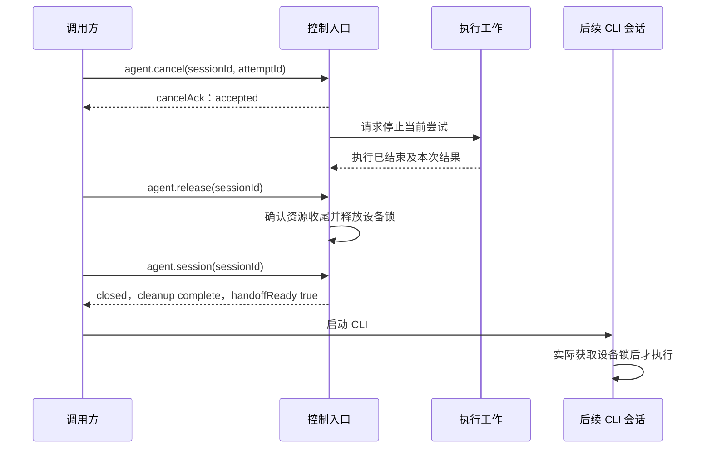

# 智能体调用协议 v1

更新日期：2026-10-29。本文确定能力查询、运行结果、失败证据和取消交接的共同约定，供执行端与调用方实现。

**当前状态：协议规范，运行接口尚未实现。** 现有 CLI、VSCode 及[录制协议](recorder-protocol.md)仍按原方式工作。下面的 `agent.*` 方法不能直接用于当前分发包；[JSON Schema](protocol/agent-v1.schema.json)和[示例](protocol/examples)用于实现与校验，不是设备测试结果。

## 1. 版本与通信

协议名为 `maestro.harmonyos.agent`，`schemaVersion` 为整数 `1`。JSONL 请求保留现有封包：

```json
{"id":1,"method":"agent.describe","params":{}}
```

`id` 仍为 1～9007199254740991 的整数，同一连接中不得复用。响应仍为 `{id,result}` 或 `{id,error}`。不向旧请求的顶层或旧 `connect/action` 参数中添加新字段；它们有严格白名单。

新方法成功响应的 `result`，以及持久化的结果和证据文件，使用相同的文档封包：

| 字段 | 含义 |
| --- | --- |
| `protocol` | 固定为 `maestro.harmonyos.agent` |
| `schemaVersion` | 当前为 `1` |
| `kind` | `capabilities`、`preflight`、`session`、`snapshot`、`cancelAck`、`runResult` 或 `evidenceIndex` |
| `observedAt` | 本次状态观察或文档生成时间，UTC、以 `Z` 结尾 |
| `revision` | 同一状态对象的非负递增修订号；内容变化时增加，不能因重新查询而倒退 |
| `data` | 对应类型的数据，由 Schema 校验 |

初次能力查询使用 `agent.describe`。调用方检查协议版本及返回的 `methods`，只调用明确列出的接口。未知主版本必须拒绝，不能猜测字段含义。返回 `UNKNOWN_METHOD` 表示该分发包没有实现该入口，不能把它解释为设备不支持某个动作。

`revision` 分别属于同一会话、同一次尝试或该尝试的证据索引，不能跨对象比较。独立预检和静态能力文档可以从 0 开始；调用方不能仅依赖主机时间判断哪份运行状态更新。

v1 的字段、枚举和语义保持固定。新增字段或枚举时更新 Schema 并协商版本，不能在原版本中偷偷改变。Schema 校验结构，执行端还必须检查文件归属、哈希、标识关系和真实设备状态。

## 2. 共用标识

| 标识 | 生成与作用域 | 不应承担的用途 |
| --- | --- | --- |
| 请求 `id` | 调用方生成的数字，仅关联本连接中的请求和响应 | 不能作为防重放标识 |
| `sessionId` | 执行端生成 UUID，表示一次设备会话；重连生成新值 | 不等于设备序列号，也不能跨会话继续使用 |
| `runId` | 调用入口在执行前生成 UUID，表示一个逻辑流程任务 | 修改流程或测试目标后应建立新任务 |
| `attemptId` | 调用入口在每次执行前生成 UUID，同一任务的重试生成新值 | 不能用一次新请求重复执行旧尝试 |
| `attemptNo` | 同一 `runId` 内从 1 开始的尝试序号，每次新增尝试递增 | 不代替全局唯一的 `attemptId` |
| `stepId` | 执行端为每次实际步骤执行生成 UUID | 循环中再次执行同一行也必须有新值 |
| `snapshotId` | 沿用录制器生成的不透明快照标识，仅在有效会话与当前页面内使用 | 不能代替稳定控件 ID，不能跨动作或重连复用 |
| `deviceId` | 本机 HDC 目标标识，留在本地结果中 | 公开示例不得使用个人设备标识 |

同一尝试的摘要、错误、步骤和证据均携带相同的 `runId`、`attemptId`。步骤另记录源 Flow、命令序号和命令名称，方便把执行实例定位到脚本；源文件行号不是步骤标识。

标识使用小写 UUID 文本，SHA-256 使用小写十六进制。`source.commandIndex` 从 0 开始，指对应源 Flow 的命令序号；同一源位置的多次执行仍使用不同 `stepId`。

执行端必须先原子地登记 `attemptId`、输入指纹和独立产物位置，再派发设备动作。已登记的尝试再次提交时返回 `ATTEMPT_ALREADY_EXISTS`，引导查询原结果，不再次执行；相同标识携带不同输入返回 `ATTEMPT_CONFLICT`。进程重启后仍检查已有登记，不能因为内存状态丢失而重新执行。找不到可信的完成结果时保留未知状态。

`runResult.input` 保存 `kind`（`action` 或 `flow`）、已归档输入文件的相对 `path` 及实际字节 SHA-256。输入记录包括动作或 Flow、实际应用/设备配置和执行参数，不包括传输请求 `id`、查询时间等无关字段。重复提交比较解析后的有效执行输入，JSON 属性顺序变化不算新输入；原归档文件和哈希保持不变。

`runResult.flow` 单独指向已经存在的 Flow 及其哈希。节点动作可能在生成 YAML 前因快照过期而失败，此时 `flow=null`，不能编造路径或哈希；原始动作输入仍通过 `input` 核对。

请求响应丢失时，调用方查询原尝试。只有明确决定进行另一次尝试时，才生成新的 `attemptId` 和 `attemptNo`；原材料不能覆盖。

## 3. 能力与环境

`capabilities` 说明这份执行端实现了什么，不通过设备试点来证明支持。每条命令包括：

- `implementation`：`supported`、`unsupported` 或 `experimental`。
- `interfaces`：该命令对应的 `cli` 或 `recorder` 入口，是否可用仍由 `implementation` 和前置条件决定。
- `requirements`：执行所需前置条件。
- `verification`：`verified` 或 `unverified`，以及历史验证的适用范围和证据引用。工具存在不能填写为已验证；没有可核对的历史记录时，使用 `unverified`。`agent.describe` 没有设备参数，其验证记录不代表本次目标设备已经验证。

`preflight` 针对明确设备及请求命令做只读检查，例如连接、目标应用、所需工具和当前会话占用。禁止为预检启动应用、点击、输入、解锁、修改权限或启动录屏。

| 检查状态 | 含义 |
| --- | --- |
| `passed` | 本次检查明确满足该条件 |
| `failed` | 本次检查明确不满足该条件，附稳定 `code` 和说明 |
| `unknown` | 未检测、无法可靠读取或响应不足以判断 |

预检 `readiness` 的计算规则固定：存在必需检查失败则为 `blocked`；否则存在必需检查未知则为 `unknown`；所有必需检查通过才为 `ready`。非必需检查的失败或未知仍保留，不改变这个汇总规则。查询必须列出实际检查范围，不能用空清单返回就绪。

检查清单至少包含一个必需检查。`verification.scope` 是验证记录的范围说明，不能代替当前设备的预检结果；填写 `verified` 时必须有非空范围和证据引用。

就绪只描述本次已列明条件，不证明业务页面、账号或网络数据一定正确，也不是设备锁租约。操作前仍需重新确认设备与会话归属。无法确认锁屏或权限时应保留未知，不默认视为通过。

## 4. 运行状态、错误与副作用

`runResult.status` 描述这次尝试的执行进展或结论：

| 状态 | 含义 |
| --- | --- |
| `pending` | 尝试已登记，尚未派发设备步骤 |
| `running` | 正在执行 |
| `cancelling` | 已受理取消，正在停止执行 |
| `passed` | 流程执行通过 |
| `failed` | 已确认执行失败 |
| `blocked` | 执行前因环境、能力或输入问题拒绝，没有设备副作用 |
| `cancelled` | 执行工作已结束，取消结果已确认；不表示此前操作被回滚 |
| `unknown` | 无法确定执行结论，例如进程或通信中断后失去可信结果 |

前三项为进行中状态，`endedAt` 必须为空。其余为终态，记录确定该终态的时间；`unknown` 的结束时间是停止追踪的时间，不冒充设备完成时间。已确认的终态不能被迟到取消改写。

`startedAt` 表示实际开始执行步骤的时间；执行前 `blocked` 的开始时间和失败步骤标识均为空。进行中状态与 `passed` 的 `error` 为空；`failed/blocked/cancelled/unknown` 必须有结构化错误。`passed` 的失败步骤标识为空。

错误单独使用 `{kind,code,message,details?}`。`kind` 固定为 `assertion`、`environment`、`unsupported`、`timeout`、`cancelled`、`invalid_input`、`transport`、`internal`。`code` 是稳定机器码，`message` 用于展示；分类来自异常类型与执行上下文，不解析中英文报错文案。无法可靠分类时归为 `internal` 并保留原始诊断，不猜测业务根因。

共同错误码按以下含义实现。更细的错误码可以增加，但不能改变已有含义；调用方不识别具体 `code` 时按 `kind` 处理，仍保留原码和说明。

| `kind` | 共同错误码 |
| --- | --- |
| `invalid_input` | `INVALID_REQUEST`、`INVALID_PARAMS`、`NOT_FOUND`、`ATTEMPT_ALREADY_EXISTS`、`ATTEMPT_CONFLICT`、`STALE_ATTEMPT` |
| `unsupported` | `UNKNOWN_METHOD`、`UNSUPPORTED_COMMAND` |
| `environment` | `DEVICE_NOT_FOUND`、`DEVICE_UNAUTHORIZED`、`DEVICE_LOCKED`、`DEVICE_BUSY`、`APP_NOT_INSTALLED`、`PRECONDITION_UNKNOWN`、`STALE_SNAPSHOT`、`AMBIGUOUS_SELECTOR` |
| `assertion` | `ASSERTION_FAILED` |
| `timeout` | `OPERATION_TIMEOUT` |
| `cancelled` | `CANCELLED` |
| `transport` | `DEVICE_DISCONNECTED`、`EXECUTOR_LOST` |
| `internal` | `INTERNAL_ERROR`、`CLEANUP_FAILED` |

不能确认设备确实未授权或锁屏时，使用 `PRECONDITION_UNKNOWN`，不能凭连接失败猜测具体原因。协商前收到的旧桥接错误可能只有 `code/message`；只有协商成功的新方法才适用完整的新错误约定。

超时属于错误类型，不单独决定执行结论。明确确认操作失败时可用 `failed + timeout`；无法确认操作结果时用 `unknown + timeout`。环境中断发生在已执行的步骤之后时，不能改写成执行前的 `blocked`。

`effects` 汇总整次尝试的设备副作用：

- `none`：确认没有设备副作用。
- `possible`：至少存在一个无法确认是否生效的动作。
- `observed`：已观察到设备动作的效果，且没有未决动作；不保证效果符合业务预期。

只读断言和截图不能把此前点击、输入的副作用清零。有未决动作时优先保留 `possible`。`blocked` 必须为 `none`；`cancelled` 可以是以上任一值。超时、取消或通信错误都不能被调用方当成“动作没发生”，据此自动重发点击、输入或提交。

流程结果与清理结果分别返回。`passed` 不代表设备已经释放；`error` 为原始执行错误，额外的收尾错误放到 `cleanup.errors`，不能覆盖原错误。没有发生 Flow 步骤的失败可以没有 `failedStepId`，但必须有结构化原因。

## 5. 取消、释放与接管

取消返回 `cancelAck`，其中 `acceptance` 仅为 `accepted`、`already_requested` 或 `already_finished`。这些值表示取消请求的处理情况，不是“设备已经停止”的完成证明。

会话状态使用 `idle`、`inspecting`、`busy`、`cancelling`、`releasing`、`closed`、`unknown`。资源清理单独使用 `not_started`、`in_progress`、`complete`、`failed`、`unknown`；锁状态单独使用 `held`、`released`、`unknown`。

`idle` 持有锁且没有活动尝试；`inspecting` 正在读取快照，持有锁且没有动作尝试；`busy/cancelling` 持有锁且必须指向活动尝试；`closed` 没有活动尝试。清理为 `complete` 时错误列表必须为空，为 `failed` 时必须有清理错误。运行结果中的清理状态只涉及该次尝试的资源；交接判断使用会话级清理状态，包含设备锁和本会话全部资源。

`handoffReady=true` 必须同时满足：

1. 会话为 `closed`，`activeAttemptId` 为空。
2. 当前执行工作已经结束，自己持有的执行子进程已经结束。
3. 本会话负责的录屏、临时资源及输出收尾已确认完成，`cleanup.state=complete`。
4. 本会话设备锁已释放，`lockState=released`。

执行端只有核实这些事实后才能发布完成状态；清理失败或无法确认时返回 `handoffReady=false`。关闭 UI、设置 `busy=false`、发送终止信号或终止函数返回，都不能单独证明完成。



取消只针对指定会话中指定的尝试。目标不匹配返回 `STALE_ATTEMPT`，不停止后来开始的任务。重复取消、重复释放不产生额外设备动作；对已经结束的尝试取消不能改变其结果。

释放请求会停止接收新的设备动作；若有正在执行的尝试，先请求取消并等待其结束，再收尾。受理释放后会话可处于 `releasing`，调用方继续查询，不能仅根据释放请求已返回就接管。超出等待预算时保持未确认状态，不假报释放成功。

接管方仍须实际获取同一设备锁。上一会话已经释放，不保证中间没有其他进程取得设备；`handoffReady` 不是对下一调用方的独占预约。设备文件锁也不能阻止手机上的手工触摸或外部 HDC 操作。

当前桥接在执行动作时同步阻塞读取。实现新协议时必须让状态、取消与释放请求在动作执行中仍可处理；仅在现有同步分支里增加 `cancel` 方法不符合本规范。新动作入口采用登记后立即返回、后续查询结果的方式，控制请求与执行工作分离，设备动作仍严格串行。

## 6. 结果与证据文件

每次尝试使用独立的输出目录，输入 Flow 和脚本只读。摘要与证据索引纳入上游产物 bundle 和 manifest，不放在输入 YAML 旁。已有 JUnit、`manifest.json` 和命令产物继续保留，统一摘要不另造一套测试执行器。

`runResult` 固定携带任务与尝试标识、尝试序号、会话与设备、原始输入指纹、已存在的 Flow 信息或空值、起止时间、状态、错误、副作用、清理状态、失败步骤和产物引用。`artifacts.baseDir` 是本次尝试的输出根目录，输入归档和产物引用均为该目录下的相对路径，使用 `/`，不能含 `..` 路径段、盘符、绝对路径或反斜杠。源 Flow 的位置属于输入信息，不授权覆盖或修改该文件。执行端还要校验解析后的真实产物路径没有通过符号链接逃出输出根目录。

`evidenceIndex` 将具体执行步骤与证据关联。证据类型包括 `screenshot`、`hierarchy`、`log`、`commands`、`video`；每项包含：

- 所属尝试和步骤；执行前拒绝等情况可以没有具体步骤。
- `phase`：动作前 `before`、动作后 `after` 或失败留证 `failure`。
- 采集时间、相对路径和 SHA-256。
- `state`：`available`、`missing` 或 `capture_failed`，采集失败附自己的错误。

`available` 必须对应已经完成写入且可核对的文件；缺失文件不能填写可用。设备离线时可能无法取得新截图或布局，应明确缺失或采集失败，并保留日志，不能用旧截图冒充失败时状态。截图和布局分别记录采集时间，不能宣称原子一致。

失败时先保留原执行结果，再尽力采集证据。采集有自己的有限等待预算，不重发业务动作、不覆盖原错误、不阻止取消永久完成。新尝试另建目录，首次失败的摘要、材料和时间不得被后续成功覆盖。

状态文件以临时文件写入并原子替换；修订号递增。服务异常退出留下的 `running` 文件不能被读者猜成通过；恢复时必须核实原执行状态，无法核实时形成 `unknown` 记录。调用方查询不存在的尝试时得到 `NOT_FOUND`，不返回虚构的成功结果。

## 7. 方法约定与分批实现

所有新方法只控制该执行端持有的会话和产物，不结束其他应用或工具的进程。新接口采用下表方法名；参数中的标识均按上述作用域验证。

| 方法 | 参数 | 返回与行为 |
| --- | --- | --- |
| `agent.describe` | `{}` | `capabilities`，列出实际已实现的方法及命令 |
| `agent.preflight` | `{deviceId,commands,appId?,abilityName?,moduleName?}` | `preflight`，`commands` 必须非空；按请求范围只读检查 |
| `agent.connect` | `{deviceId,appId,abilityName,moduleName?,artifactsDir}` | `session`；使用与原录制器相同的设备锁，显式目标，不自动换设备 |
| `agent.session` | `{sessionId}` | `session`，执行期间也能读取 |
| `agent.snapshot` | `{sessionId}` | `snapshot`，包含 `sessionId` 及原录制快照的图片、尺寸、节点和 `snapshotId`；不生成动作尝试 |
| `agent.action` | `{sessionId,runId,attemptId,attemptNo,action}` | `runResult`；登记后立即返回当前状态，不等待动作结束；`action` 使用原录制器七类动作及参数 |
| `agent.cancel` | `{sessionId,attemptId}` | `cancelAck`；不表示执行或清理已经结束 |
| `agent.release` | `{sessionId}` | `session`；受理释放后拒绝新动作，查询完成状态 |
| `agent.result` | `{runId,attemptId}` | `runResult`；读已有尝试，不触发重跑 |
| `agent.evidence` | `{runId,attemptId}` | `evidenceIndex`；只读取，不重新操作设备采证 |

`agent.action` 在新协议中把一条录制动作视为一次明确的执行尝试；完整 Flow 的运行继续由 CLI 承担。两者使用相同的结果与证据格式，不承诺通过当前录制桥接执行任意 Flow。CLI 的取消由拥有该 CLI 进程的调用入口处理，并遵守相同的结束、清理和交接条件。

`agent.snapshot` 仅在 `idle` 会话中受理，读取期间进入 `inspecting`，不排队执行新的设备动作；冲突请求返回 `DEVICE_BUSY`。读取完成恢复 `idle`，返回节点只对该会话与快照有效。释放请求可以中止或等待这项只读工作结束，再按释放条件确认；没有动作尝试时不能伪造一个 `attemptId` 来接受取消。

请求格式错误、未知方法、未知对象和标识冲突使用封包中的 `error`。已经建立尝试之后发生的执行失败写入 `runResult`；调用方不能把“查询请求成功”误当成“流程通过”。现有旧方法的响应语义保持兼容。

**第一批：能力查询与取消交接。** 实现共用标识登记、状态查询和基础结果，以及 `agent.describe/preflight/connect/session/snapshot/action/cancel/release/result` 九个方法。基础结果须符合 v1 Schema，尚未生成的证据路径为空。重点是只读预检、执行期间可达的取消、结果未知的保留和确认释放。旧 VSCode 不必同时迁移。

**第二批：统一结果与证据索引。** 把 CLI、录制动作和矩阵的实际错误、JUnit/manifest、步骤与文件纳入统一摘要，实现 `agent.evidence`。第一批已有字段不换名、不改含义；补全实际分类和证据覆盖，不能用“未知”长期代替已有类型信息。

## 8. 每批必须通过的检查

第一批至少覆盖：旧五方法和现有插件兼容；无设备、设备占用与未知前置条件；长动作执行中能受理取消；取消后实际获取设备锁接管；迟到或重复取消不影响下一次尝试；断连或超时不自动重发；未确认清理时不返回可接管。

第二批至少覆盖：断言失败、环境阻塞、超时和取消分别归类；每项失败关联到尝试和步骤或明确的执行前阶段；设备失联时如实记录证据缺失；动作成功但画面刷新失败不重做动作；重跑保留原尝试；Schema 校验与实际文件、哈希、manifest 引用一致。

完成记录写明主机测试、集成测试和真机结果。协议样本及 Schema 校验只证明格式和约束，不能代替运行实现或设备验证。

可在仓库根目录使用 PowerShell 7 校验样本：

```powershell
$schema = './docs/protocol/agent-v1.schema.json'
Get-ChildItem ./docs/protocol/examples -Filter '*.json' -File | ForEach-Object {
  if (-not (Test-Json -Json (Get-Content -LiteralPath $_.FullName -Raw) -SchemaFile $schema)) {
    throw ('协议样本无效：' + $_.Name)
  }
}
```

调用方使用支持 JSON Schema 2020-12 的校验器并启用日期时间格式校验。Schema 不能核实真实文件、设备副作用或资源释放，这些仍须由执行端的实现和测试证明。
