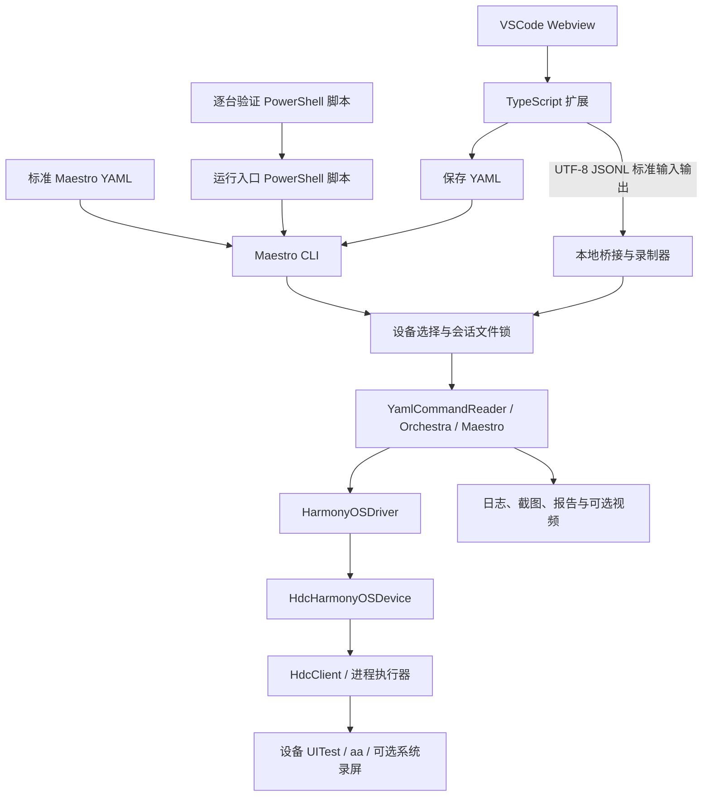
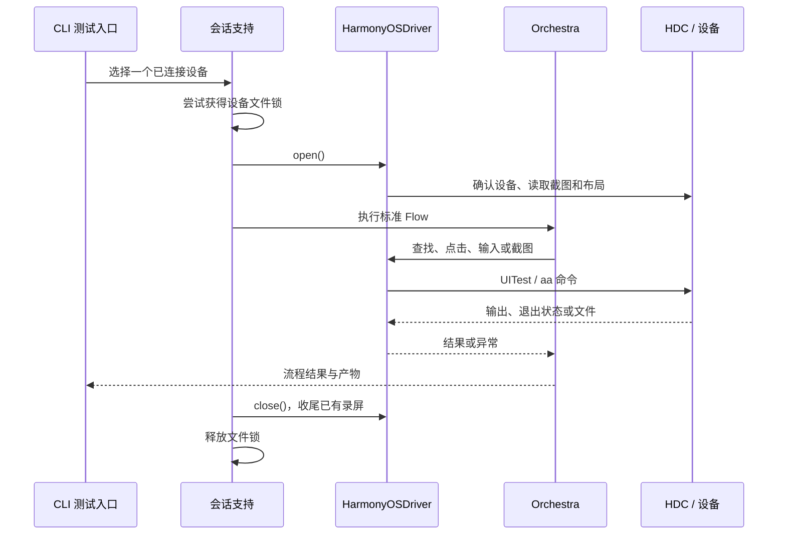
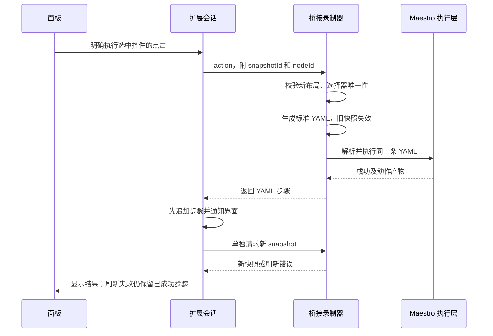

# Maestro HarmonyOS 开发设计

更新日期：2026-10-30。本文描述当前仓库实现；尚未实现或未验证的部分单独列出。安装与操作见[使用指南](user-guide.md)，环境配置见[环境说明](setup.md)，消息和磁盘文件格式见[协议索引](protocol/README.md)。

## 1. 项目解决什么问题

Maestro HarmonyOS 让开发者在电脑上用 Maestro YAML 驱动鸿蒙应用，完成点击、输入、滑动、断言和截图，并保存执行结果。测试流程可以手工编写，也可以在 VSCode 中点选设备截图、执行操作后生成。

例如，一个应用修改了登录页，维护者希望每次构建后检查“打开页面 → 找到输入框 → 输入测试文字 → 确认文字显示”。本项目负责把这份 YAML 交给 Maestro 执行，再通过 HDC 和设备上的 UITest 操作真实界面。页面文字、控件 ID、包名和预期结果由测试编写者提供。

这是运行在开发电脑上的测试工具和 Maestro 平台适配代码。使用者不需要把它作为 HAR 引入业务应用。当前实现也没有要求在应用里嵌入录制 SDK；前提是目标设备允许 HDC 调试，并提供实现所需的 UITest 命令。应用自身仍需提前安装、完成必要授权并处于可测试状态。

主要使用者是鸿蒙应用开发者、测试人员，以及需要维护 HarmonyOS 驱动的贡献者。它适合页面冒烟检查、重复回归、失败留证和同一流程的逐台验证。业务接口单元测试、应用打包签名、性能压测和应用市场发布不属于当前职责。

### 实现边界

| 范围 | 当前做法 |
| --- | --- |
| 流程语法 | 复用固定上游的 YAML、参数、条件和子 Flow，不增加鸿蒙专用 DSL |
| 执行环境 | 已在 Windows、JDK 17 和一台已授权的真机验证；现有运行脚本仅支持 Windows |
| 应用 | 当前以原生 ArkUI 页面为验证对象；自绘区域能否定位取决于设备布局树是否提供节点 |
| 设备连接 | 本机 HDC；单个 CLI 会话操作一个目标设备 |
| 编辑辅助 | VSCode 生成标准 YAML；记录插件发出的操作，不采集手机手工触摸 |
| 批量执行 | 复用上游 Flow 批量执行；矩阵脚本按指定设备逐台调用，不并发分片 |
| 固定输入与统计 | CI 核对冻结输入和原生 JUnit；验证计划另行固定分母、必测步骤和首次/最终成功口径 |
| 视频录屏 | Huawei 系统录屏实验后端，默认关闭；与操作生成 YAML 是独立功能 |
| 未支持 | HAP 自动安装、清除应用数据、修改权限、Studio/MCP 鸿蒙会话、自动创建模拟器等 |

上游有某条 YAML 命令，不代表鸿蒙驱动已经实现其设备行为。未支持的设备操作明确报错，不能用空操作返回成功。

## 2. 总体结构



两条入口共享设备执行层：CLI 读取用户的 Flow；录制器生成单条 YAML，再交给同一个解析器和 Orchestra 执行。插件收到成功结果后才追加步骤，因此“录制时执行的动作”和“保存后回放的动作”使用同一条命令路径。

### 仓库与上游的关系

本仓库固定上游 Maestro 提交 `3fc4ef3fc408bc70ea9baf0bac0ff3e4b565710c`，来源和检出位置由 [upstream.lock.json](../upstream.lock.json) 记录。

```text
maestro-harmonyos/
├── upstream.lock.json             上游来源和固定提交
├── patches/maestro/               适配源码与测试的完整补丁
├── .upstream/maestro/             应用补丁后的本地上游工作副本，不提交
├── host-tests/                   HDC 和布局的独立主机测试工程
├── scripts/                      准备、构建检查、执行与矩阵工具
├── packages/vscode/              扩展源码、Webview、测试与打包配置
├── examples/flows/               参数化 YAML 示例
├── docs/                         设计、使用、测试计划和验证记录
└── artifacts/                    本机测试产物，不默认提交
```

JVM 适配代码保存在 [0001-harmonyos-host.patch](../patches/maestro/0001-harmonyos-host.patch)，不是另一份独立维护的驱动副本。开发时在 `.upstream/maestro` 修改真实上游代码，交付时导出补丁，并在固定基线上回放检查。补丁也包含平台枚举、CLI 分支和录屏收尾等必要的上游改动。VSCode 与 PowerShell 源码直接由本仓库管理。

`prepare-upstream.ps1` 用于首次获取基线，不能作为日常“重置”命令。已有适配改动时直接使用补丁检查和测试入口。补丁脚本会拒绝不完整补丁与已有改动的混合状态，不自动执行 `reset` 或 `clean`；规则见[补丁维护说明](../patches/maestro/README.md)。

## 3. 模块职责与代码入口

下表中以 `maestro-` 开头的源码路径均相对本地 `.upstream/maestro/`。这些文件通过上面的版本化补丁交付，浏览本仓网页时应查看补丁；直接点击忽略目录不会获得源文件。

| 模块 | 主要入口 | 负责什么 |
| --- | --- | --- |
| HDC 进程 | `maestro-client/.../maestro/harmonyos/hdc/HdcCommandRunner.kt` | 原生进程参数、输出读取、超时、中断、子进程结束 |
| HDC 客户端 | `maestro-client/.../maestro/harmonyos/hdc/HdcClient.kt` | 设备列表、目标选择、远端 shell 参数、文件接收 |
| 布局读取 | `maestro-client/.../maestro/harmonyos/layout/HierarchyReader.kt` | 导出布局、拉取文件、大小和编码检查、临时文件清理 |
| 布局转换 | `maestro-client/.../maestro/harmonyos/layout/UitestLayoutParser.kt` | UITest JSON 到 Maestro `TreeNode` |
| 设备后端 | `maestro-client/.../maestro/harmonyos/driver/HdcHarmonyOSDevice.kt` | 设备命令结果确认、截图、布局及录屏后端入口 |
| 驱动接口 | `maestro-client/src/main/java/maestro/drivers/HarmonyOSDriver.kt` | 实现 Maestro `Driver`，映射应用、输入、手势、等待等行为 |
| 驱动配置 | `maestro-client/.../maestro/harmonyos/driver/HarmonyOSDriverConfig.kt` | Ability、module、超时、轮询与录屏开关和限制 |
| CLI 会话 | `maestro-cli/.../maestro/cli/session/HarmonyOsSessionSupport.kt` | 参数约束、设备选择、跨进程文件锁、关闭会话 |
| 桥接命令 | `maestro-cli/.../maestro/cli/command/HarmonyOsBridgeCommand.kt` | `harmonyos-bridge` 命令入口 |
| 桥接协议 | `maestro-cli/.../maestro/cli/harmonyos/HarmonyOsBridgeServer.kt` | JSONL 校验、请求分发、会话存续、错误响应 |
| 录制执行 | `maestro-cli/.../maestro/cli/harmonyos/HarmonyOsRecorder.kt` | 截图与布局核对、选择器、生成并执行 YAML |
| 视频录屏 | `maestro-client/.../maestro/harmonyos/driver/HarmonyOSSystemScreenRecorder.kt` | 所有权检查、启停、导出与清理；`Mp4RecordingValidator.kt` 检查文件结构 |
| 扩展控制 | [extension.ts](../packages/vscode/src/extension.ts) | 命令、Webview、配置、设备选择、保存文件 |
| 扩展状态 | [session.ts](../packages/vscode/src/session.ts) | 连接、动作、步骤、回放和取消之间的状态转换 |
| 扩展进程 | [bridge.ts](../packages/vscode/src/bridge.ts)、[launcher.ts](../packages/vscode/src/launcher.ts) | JSONL 通信、Java 启动、CLI 回放和自身进程清理 |
| 面板与校验 | [protocol.ts](../packages/vscode/src/protocol.ts)、[media](../packages/vscode/media) | 消息校验、快照结构、截图坐标换算与展示 |
| 运行脚本 | [run-harmonyos.ps1](../scripts/run-harmonyos.ps1) | 本地配置、UTF-8 输出、参数传递、产物目录、真实退出码 |
| 逐台验证 | [test-device-matrix.ps1](../scripts/test-device-matrix.ps1) | 计划轮次、环境探测、逐台执行和报告汇总 |
| 重试追踪 | `maestro-cli/.../maestro/cli/harmonyos/HarmonyOsRetryTrace.kt`、`HarmonyOsCliAgentReport.kt` | 实际步骤、来源身份、retry 上下文与独立 v2 trace/summary |
| 固定验证计划 | [test-validation-plan.ps1](../scripts/test-validation-plan.ps1)、[validation](../scripts/validation) | 冻结输入、保留计划分母、核对覆盖与统计资格 |
| CI 输入与质量 | [run-device-suite.ps1](../scripts/ci/run-device-suite.ps1)、[InspectFlows.java](../scripts/ci/InspectFlows.java) | 真实解析器预检、构建与工具文件冻结、设备释放及原生 JUnit 核对 |
| 录屏诊断 | [collect-recording-diagnostics.mjs](../scripts/collect-recording-diagnostics.mjs)、[verify-recording.ps1](../scripts/verify-recording.ps1) | 分别收集阶段观察和检查原视频完整解码；不改写原执行结论 |

表中省略的 `...` 均为 `src/main/java`。修改设备语义应从驱动或设备后端开始；扩展不自行拼接 HDC 命令。

## 4. CLI 与设备会话

### 设备发现和配置

CLI 显式使用 `--platform harmonyos`。平台分支接入设备列表、测试执行、布局查询和 `MaestroSessionManager`，设备列表来自 `hdc list targets`。

没有指定目标且只有一台设备时可以选中它；无设备、多设备未指定或指定目标不在线时给出错误。不根据列表顺序偷偷切换目标。HarmonyOS 不接收 Android/iOS 的远程驱动端口、Apple team、设备索引等参数；测试入口也拒绝多设备分片和 Web Flow。

YAML 的 `appId` 对应 bundle 名称；启动 Ability 和可选 module 由 `MAESTRO_HARMONYOS_ABILITY`、`MAESTRO_HARMONYOS_MODULE` 提供。运行脚本把参数转为这些配置，录制器则用连接参数构造 `HarmonyOSDriverConfig`。

`Orchestra.launchAppCommand` 对鸿蒙不再隐式执行其他平台的默认“全部授权”。应用使用当前已有权限；用户显式要求设置权限时，仍进入驱动并按支持情况报错。这样不会把“启动成功”误写成“权限已处理”。

### 文件锁与释放顺序

`HarmonyOsSessionSupport.withSession` 先获取设备文件锁，再创建 `HarmonyOSDriver` 和 `Maestro`，执行调用方代码，最后关闭会话并释放锁。锁文件名由设备标识的 SHA-256 生成，位于当前用户目录下的 `.maestro/harmonyos-sessions`。

使用 `FileChannel.tryLock()` 让同一主机、同一锁目录中的 CLI 与录制器互斥。锁文件关闭后保留空文件，避免删除文件后另一个进程通过新文件取得第二把锁。空文件存在不表示设备仍被占用。

锁不阻止手机手工触摸、外部 HDC 命令或另一套使用不同锁目录的程序。因此运行期间仍需保持设备状态可控，不能把文件锁当作设备系统级隔离。

正常返回、异常和关闭钩子共用只执行一次的关闭过程。流程已经失败时，关闭错误不能覆盖原错误；执行结果与清理状态分别保存，调用方需要同时检查。强制杀进程或设备失联不能保证所有设备临时资源均被清理。

文件锁释放也不等于资源已经清理。持久 owner 记录、命令日志和录屏资源登记会保留未确认状态，阻止新会话；恢复边界见第 17 节。不能用删除锁文件或清空状态目录代替恢复。



## 5. HDC、设备命令与文件

### 两层命令边界

电脑进程参数和设备 shell 参数分别处理。`ProcessHdcCommandRunner` 使用 `ProcessBuilder` 启动 HDC，不通过电脑端 `cmd /c` 拼接整条命令。Windows JDK 17 对引号的处理有差异，执行器按原生参数规则编码；HDC 必须是原生可执行文件，不能用 `.bat` 或 `.cmd` 替代。

`HdcClient.shell` 再对设备侧每个参数进行 shell 引号转义。用户输入中的空格、引号和特殊字符不能成为额外的 shell 指令，NUL 字符明确拒绝。

HDC 进程退出 0 仅表示传输层结果，不能据此确认设备动作成功。`HdcHarmonyOSDevice.execute` 为本次命令附加唯一的远端退出状态标记，并要求标记处于输出末尾。它继续检查设备错误文本；对于 `uitest uiInput`，还必须得到 `No Error` 且标准错误为空。应用启动、停止另检查 `aa` 的明确成功回执。

布局读取走 `HierarchyReader` 的专门文件流程：检查 dump 错误、确认新文件确实接收成功并能解析，不使用旧文件冒充本次输出。

### 超时、输出和清理

| 约束 | 当前默认值或规则 |
| --- | --- |
| HDC 设备列表等客户端调用 | 默认 10 秒 |
| 驱动单条设备命令 | 默认 15 秒 |
| 通用布局稳定等待 | 默认 5 秒，100 毫秒轮询 |
| HDC 标准输出与标准错误 | 各自最多 4 MiB，分别读取，避免某一管道阻塞 |
| 布局文件 | 最多 8 MiB，严格 UTF-8 |
| PNG 文件 | 最多 32 MiB；解码后最多 1600 万像素 |
| 截图或布局临时清理 | 独立的小额超时预算，通常 2 秒 |

截图与布局每次使用 UUID 临时文件名。设备端文件位于 `/data/local/tmp`，主机文件位于本次临时目录；在本次请求完成后清理。接收后检查文件类型、大小、读取前后大小是否一致，防止把缺失、空文件或不完整传输当作成功。

执行器在超时、中断或读取失败时结束自己启动的 HDC 进程及已发现的子进程，保留原始错误。设备清理失败要报告；已中断且无法安全继续清理时，错误中保留可能残留的临时文件位置。

这些上限用于约束单次操作的等待和内存使用，不是对所有设备的性能承诺。

## 6. 布局模型与定位

`UitestLayoutParser` 读取 UITest 的 `attributes` / `children` 结构，保留父子关系并转换为真实 Maestro `TreeNode`。也可解析窗口数组并添加无点击坐标的合成根节点。

| UITest 数据 | Maestro 映射 | 说明 |
| --- | --- | --- |
| `id`，缺省时 `key` | `resource-id` | 使用控件 InspectorKey；运行时 `accessibilityId` 不作为稳定资源 ID |
| `text` | 原文字属性 | 由上游文本选择器使用 |
| `hint` | `hintText` | 用于输入提示匹配 |
| `type` | `class` | 保留控件类型 |
| `bounds` | `[left,top][right,bottom]` | 物理像素，包含系统栏位置 |
| `enabled`、`clickable`、`focused`、`checked`、`selected` | `TreeNode` 对应状态字段 | 缺失或空状态保持未知，不默认设为真或假 |
| `visible=false` | 保留节点但去掉可点击边界 | 父节点隐藏不直接丢弃所有子节点 |

边界方向颠倒、非法布尔值、重复 JSON 字段、额外尾部内容或错误结构都报错。零面积节点没有点击边界。解析还限制最大深度 128 和节点数 50,000，避免异常布局占用无限资源。

标准 YAML 继续使用 Maestro 选择器；滑动、跳转或弹窗后重新读取布局。录制器额外要求生成的选择器能唯一对应当前节点，依次尝试 ID、文字、输入提示；使用上游同一组匹配过滤器检查，而不是只看展示列表。

截图点选在扩展里先把显示坐标换算为截图物理像素，选择包含该点的合适节点。点选只改变选中状态，必须再点击操作按钮才向手机发命令。没有可靠选择器时，可以明确选择坐标点击；坐标流程对设备尺寸和页面变化更敏感，应单独评估跨设备适用性。

## 7. 驱动行为与等待

`HarmonyOSDriver` 实现上游 `Driver` 接口，设备细节由可替换的 `HarmonyOSDevice` 承担。生产环境使用 `HdcHarmonyOSDevice`，主机测试可以注入模拟设备，但仍测试真实驱动。

| 驱动行为 | 设备映射或处理 |
| --- | --- |
| 打开会话 | 设备可用性检查，实际读取一张 PNG 和一份布局 |
| 启动应用 | `aa start -b <bundle> -a <ability>`，可选 `-m <module>` |
| 停止、结束应用 | `aa force-stop <bundle>` |
| 点击、长按 | `uitest uiInput click` / `longClick`；坐标必须在屏幕内且大于 0 |
| 输入文字 | `uitest uiInput text`；空串不发送输入命令，NUL 拒绝 |
| 删除文字 | 按字符数发送退格键，计数范围 0～10,000 |
| 按键 | 映射已实现的返回、主页、电源、回车、退格、Tab、Escape、音量键；其他键报不支持 |
| 滑动 | 起终点和时长换算为 UITest 速度，限制在 200～40,000；时长是近似值 |
| 截图 | `uitest screenCap` → 文件接收 → PNG 格式和尺寸检查 → 写入 Maestro 输出 |
| 布局、断言 | 布局转 `TreeNode`；断言和选择器判断由 Maestro / Orchestra 执行 |

启动参数目前只映射支持的字符串、布尔值和非负 32 位整数；其他类型报错。不要把 Android intent 参数直接当成鸿蒙 Ability 参数使用。

通用等待有两条路径：`waitUntilScreenIsStatic` 比较连续 PNG 像素，`waitForAppToSettle` 比较连续新布局。它们使用截止时间，超时返回上游约定的未稳定结果，不伪造成功。调用方传入的旧布局不能替代两个新采样。

录制器使用第 8 节单独描述的布局稳定检查。状态栏排除只发生在录制器的比较视图里，没有修改共享驱动的通用等待，也没有改变标准 CLI 流程的布局内容。

驱动不自动解锁、关闭输入法、清除应用状态或授予权限。`capabilities()` 不宣称尚未实现的平台特性；具体不支持的方法抛出 `UnsupportedOperationException`。是否允许业务重试由 Flow 和上游执行层决定，不能通过在 HDC 层盲目重发点击来掩盖错误。

## 8. 录制桥接与 YAML 生成

### 协议和会话

`harmonyos-bridge` 是插件启动的常驻 Java 子进程。通信使用 UTF-8 JSON Lines 标准输入输出，不监听本地网络端口。CLI 启动时提前保留协议输出流，将普通输出重定向到标准错误，避免日志混进 JSON。

请求含正整数 `id`、`method` 和对象 `params`，响应为同一 `id` 对应的 `result` 或 `error`。原五方法 `devices`、`connect`、`snapshot`、`action`、`disconnect` 供现有插件使用；新增 `agent.*` 入口见第 16 节。接口不接受任意 shell。单请求上限 64 KiB，成功响应上限 32 MiB。原字段与错误格式见[协议文档](recorder-protocol.md)。

服务端串行读取请求。`connect` 进入 `withSession` 后保持会话，`disconnect` 必须等驱动关闭、文件锁释放后才返回确认。输入 EOF 也退出会话。设备错误会转换为可读错误，完整诊断留在标准错误。

### 快照一致性

截图和布局由不同的设备命令取得，不能声称是同一时刻的原子快照。录制器采取以下检查：

1. 使旧快照失效，开始一个新的 20 秒稳定采样预算。
2. 连续读取布局，间隔 100 毫秒，等待两次比较视图一致。
3. 获取截图，再读一次布局，确认读取期间页面未变化。
4. 检查图片尺寸与本次 Maestro 会话缓存的尺寸一致；变化时要求断开重连。
5. 返回唯一 `snapshotId`、PNG、尺寸和可选节点；节点 ID 只在该快照内有效。

状态栏上的时钟和网速会让整个布局持续变化。实现仅排除满足全部条件的系统栏子节点动态内容：`bundleName` 为 `com.ohos.sceneboard`、类型为 `WindowScene`、包含 `StatusBarBox`、与目标应用窗口不重叠。该窗口自身的属性、位置和出现/消失仍参与比较；键盘、弹窗、重叠窗口和未知系统内容继续保留。排除区域不提供录制节点，也不能用坐标点击绕过。

执行节点或坐标动作前再次检查 `snapshotId` 和新布局。节点动作还重新核对选择器仍唯一匹配原节点。过期、歧义或不稳定返回错误，由使用者刷新后重选。设备页面可能在最后一次核对后继续变化，这些检查降低错误点击的机会，不能保证设备界面完全静止。

### 执行动作与保存步骤

录制器支持启动、点击、输入、滑动、返回、可见断言和截图七类动作。用户参数先校验，再查询设备或执行；截图名称限定为安全的短文件名，产物写到本次动作目录。



每个动作通过 `YamlCommandReader.readSingleCommand → Orchestra.runFlow` 执行，生成独立产物目录。失败返回错误，不追加假成功步骤；失败也可能发生在设备已经发生部分变化之后，所以不能据此自动重发动作。录制器生成的点击显式设置 `retryTapIfNoChange: false`。

文字转为 YAML 时使用 JSON 字符串编码，并按固定上游的规则处理字面 `${...}`。单层表达式按原文字保存，不能无损往返的嵌套或未闭合表达式明确拒绝，不执行其中的 JavaScript。ID 和文字选择器使用正则字面转义，防止输入中的 `.`、`*` 等字符改变匹配范围。

## 9. VSCode 扩展状态与进程

扩展使用 TypeScript、VSCode API 和静态 Webview，运行时没有额外 npm 依赖。Java、HDC 和已构建 CLI 由使用者配置，VSIX 不内置这些工具。

`RecorderSession` 管理 `connected`、`busy`、当前快照和已录步骤。连接、刷新、动作、断开和回放通过统一的操作入口串行执行。停止时递增会话世代并触发 `AbortSignal`，每个异步阶段完成后核对世代；已经取消的连接、截图或回放准备不能用迟到响应恢复状态或追加步骤。

`BridgeClient` 使用 UTF-8 分块解码，按请求 ID 匹配响应，一次只保留一个正在等待的请求。默认请求超时 90 秒；超时、协议损坏或子进程退出会清理连接状态，保留成功步骤，提示检查手机后重连。超时意味着执行结果不确定，不等于“手机没动过”。

回放顺序固定为：在内存中组成当前面板的 YAML → 释放录制会话并取得确认 → 创建独立运行目录并写入 YAML → 启动真实 CLI → 收集退出码和日志。每个准备阶段都检查取消信号，停止后不能继续启动新进程。手工编辑已经保存的文件不会同步覆盖面板步骤；要运行编辑后的文件，应走 CLI 文件入口。

关闭面板、停止任务或停用扩展时，只清理扩展自己持有的桥接和回放进程。正常停止先结束标准输入，给桥接关闭机会；超时后结束其进程。已录步骤只保存在当前扩展会话内，重启 VSCode 前应保存 YAML，当前没有自动恢复草稿设计。

Webview 通过 nonce 和 CSP 限制脚本、样式与图片来源，设备文本按文本内容渲染；消息在进入设备调用前再次校验。工作区必须受信任。扩展不会执行仓库中的 `config.local.ps1`，已打开 VSCode 的环境也不会自动继承另一个终端后设的临时变量。

## 10. 批量执行与逐台验证

单设备批量运行继续使用上游 `test` 的文件或目录入口。`run-harmonyos.ps1` 只负责找到已构建分发包、传入应用和设备配置、创建唯一产物目录并返回 CLI 原退出码；它不自动构建、下载或安装应用。

脚本直接启动 Java，避免 `.bat` 再解释中文和引号。对 Windows JDK 启动器无法原样接收的命令行文字，在操作设备前拒绝，并建议写入 UTF-8 YAML。`-Dfile.encoding=UTF-8` 不能解决进入 Java 前已经丢失的字符。

矩阵脚本在开始时建立“设备 × 轮次”的完整计划，逐台、逐轮调用同一入口，每轮使用独立目录。只读探测记录系统、API、工具和录屏服务是否可发现；工具存在标记为 `available-unverified`，查询异常标记为 `unknown`，不根据探测直接认定流程通过。

| 轮次状态 | 含义 |
| --- | --- |
| `pending` / `running` | 预先安排 / 当前正在执行；异常退出可能留下这些状态 |
| `passed` | 运行入口返回 0 |
| `failed` | 运行非零退出、抛异常或执行中断，包含未支持命令 |
| `not-run` | 设备不可用、发现失败或执行前中断 |

报告分母包含全部计划轮次，不删除失败和未执行项。某台设备失联后，余下轮次记为未执行，其他设备继续。`-Repeat 20` 是计划执行 20 次，不是自动重试；工具也不负责重置登录态、清空数据或恢复未知页面。

`matrix.json` 和 `matrix.md` 在关键状态变化前后通过临时文件替换更新。报告保存输入文件、适配补丁和主要实现 JAR 的哈希，以及设备环境、真实退出码和产物位置。屏幕尺寸来自本轮实际 PNG；没有图片时保持未知。人工干预字段默认 `unknown`，需要观察记录补充。

这些信息让维护者能够判断多轮是否使用同一份实现和测试输入。但单文件模式不会自动固定所有外部依赖，测试应用版本、目录外子流程、网络数据和初始状态仍需另行记录。参数、目录和报告字段说明见[逐台验证文档](device-matrix.md)。

需要核对构建文件和每个顶层场景时，使用第 19 节的 CI 入口；需要分开统计首次成功、重试后成功和必测步骤覆盖时，使用第 18 节的验证计划。矩阵执行结果本身不提供这两层结论。

## 11. 实验性视频录屏

标准 `startRecording` / `stopRecording` 通过 `HarmonyOSDriver` 调用 `HarmonyOSSystemScreenRecorder`。只有显式设置 `MAESTRO_HARMONYOS_RECORDING=huawei-system` 才启用；这条后端依赖 Huawei 系统录屏 Ability、媒体工具及状态查询，不能等同于通用 OpenHarmony 录屏 API。

启动前确认没有既有录屏进程或采集会话，并为本次视频生成唯一名称。记录本次进程身份，停止前再核对所有权，避免停止其他录屏。系统接口是启停切换，无法识别“同一进程被用户手工重新接管”的所有情况，测试期间需要独占录屏。

停止后先确认本次采集已结束，再按唯一名称定位媒体并导出。拉取正常返回后，在同一收尾预算内重新查询同一远端临时文件的大小；前置大小、后置大小和本地长度必须一致，才继续归档、容器校验和输出。拉取抛错时不追加查询；短收与后置查询同时失败时保留短收为主错误。长度一致不能证明内容或每帧有效。

持久会话保存资源归属和完整原件，只有校验及输出成功、又未启用保留选项时，才删除本次设备媒体。已确认结束、非空且完整接收的坏 MP4 也保留原始字节，供后续核对；短收或尺寸变化不会登记为完整归档。`MAESTRO_HARMONYOS_RECORDING_RETAIN_MEDIA=true` 会保留设备媒体并阻止交接，后续通过原会话恢复入口处理。默认最长 3 分钟、导出上限 512 MiB，达到时长上限仍报告失败，即使随后资源收尾完成也不能改成录制成功。

Orchestra 和驱动关闭会收尾尚未停止的录屏。原流程失败与收尾失败分别保留，不能用视频收尾错误覆盖原断言错误。断连、强制杀进程等情况下可能需要人工处理。

后端把启停、结束观察、导出、接收、后置大小查询、归档和清理写入阶段日志；离线收集器按录制上下文与输出路径关联视频，不从旧日志补造未观察的字段。阶段报告完整、视频可解码、执行通过和设备已释放是不同结论。`Mp4RecordingValidator` 只检查容器结构；独立 FFmpeg 工具完整解码第一条视频轨并核对原件前后哈希，不转码或修复输入。历史坏片的尾部解码错误仍可复现，根因尚未确定。操作和判断规则统一见[录屏检查与恢复](recording-diagnostics.md)，字段见[阶段诊断协议](protocol/recording-diagnostics.md)。

## 12. 错误处理与实现约束

| 失败位置 | 当前处理 | 调用方应怎么做 |
| --- | --- | --- |
| 参数或 YAML 不合法 | 尽量在设备动作前拒绝 | 修正输入，不能以重试代替校验 |
| 设备列表异常、目标不在线 | 不选备用设备 | 检查连接和授权，明确重新执行 |
| 设备已被本项目会话占用 | 文件锁获取失败 | 结束原会话后再连接 |
| HDC 超时、设备命令错误 | 保留诊断，终止该操作 | 核对手机实际状态，避免重复副作用 |
| 布局错误或文件不完整 | 不使用旧数据补成功 | 保留日志并查设备能力或传输 |
| 快照过期或选择器歧义 | 拒绝本次点选动作 | 刷新并重新选择，必要时显式坐标点击 |
| 动作成功、随后刷新失败 | 保留已生成步骤 | 只刷新画面，不重发动作 |
| 录制进程超时或退出 | 清理连接状态并保留步骤 | 检查手机后重连；不假定动作未执行 |
| Flow 失败后清理也失败 | 原错误为主，附加清理错误 | 两项均记录，必要时回收本次资源 |
| 矩阵某轮失败或未执行 | 保留轮次和非零结果 | 修复后建立新记录，不覆盖首次失败 |

这里的文件锁、参数限制和错误检查都服务于可重复的设备测试。它们不把任意第三方 Flow 变成安全沙箱；运行来源不明的 YAML 前仍需阅读其内容。测试日志和截图可能包含页面文本、路径和设备标识，默认保留在被忽略的产物目录，公开前使用专门测试数据并检查内容。

## 13. 为什么这样拆分

| 选择 | 原因与代价 |
| --- | --- |
| 复用 Maestro 执行层 | 参数、选择器、条件、子流程和报告不维护第二套；也需要跟随固定上游的行为和接口 |
| 驱动与 HDC 后端分离 | 主机测试可以验证真实驱动，后续设备能力变化集中在后端；模拟通过仍不能代替真机 |
| 以补丁维护固定基线 | 当前改动可完整回放和核对；升级上游需要审查补丁冲突及行为变化 |
| JSONL 标准输入输出 | 无需另开端口和部署服务，中文可直接传输；同一会话只串行处理请求，大截图有传输成本 |
| 成功后追加 YAML | 避免记录未成功的动作；通信中断时仍可能有“设备已执行、电脑未收到结果”的不确定状态 |
| 唯一选择器优先 | 保存后较少依赖屏幕尺寸；自绘或无唯一标识区域仍可能需要坐标及额外断言 |
| 顺序执行设备矩阵 | 与单设备锁和现有 CLI 行为一致，记录容易核对；执行时间随设备和轮次增加 |
| 录屏独立且默认关闭 | 保留可验证的基础测试路径；不能把某台设备的私有服务能力推广到所有系统 |

## 14. 贡献者如何扩展

首次获取基线、配置 JDK/HDC、构建 CLI 和各层测试命令分别见[环境说明](setup.md)、[主机测试说明](../host-tests/README.md)及[插件开发说明](../packages/vscode/README.md)。不要只修改 `.upstream` 后就认为本仓已经交付了改动。

新增一个设备动作时，按下面顺序进行：

1. 明确目标设备实际提供的公开命令、参数、成功回执和失败行为，保留可复现输入。先界定支持范围，再修改声明。
2. 判断该动作是否已有上游 YAML 命令和 `Driver` 扩展点。优先实现已有接口，避免为同一动作另建鸿蒙语法。
3. 在 `HarmonyOSDevice` / `HdcHarmonyOSDevice` 实现设备交互，在 `HarmonyOSDriver` 映射接口。补参数、超时、远端失败与清理测试，不能仅检查电脑进程退出 0。
4. 使用真实 `YamlCommandReader`、Orchestra、Maestro 和驱动补一条集成流程；必要时只替换最底层命令执行器，避免测试绕过待验证层。
5. 若要在录制面板提供该动作，再扩展协议白名单、参数校验、YAML 生成和前端按钮；确认生成命令与真实执行一致，测试停止竞态和失败后的步骤状态。
6. 在真实设备执行、保存产物并回放标准 YAML。将设备型号、系统、应用版本、首次失败与后续结果分别写入进展记录。
7. 导出包含新源码、测试和样本的完整补丁；在固定基线回放，确认回放文件与已测试工作副本相同。检查无缓存、个人路径、设备序列号或私有界面进入提交。
8. 更新支持说明、已知限制和第三方记录。只是模拟测试通过的能力，仍标为待真机验证。

改布局字段时还需验证真实 Maestro 选择器，不能只检查生成 JSON 的字段名。改输入转义时需覆盖中文、空格、单双引号、反斜杠和字面表达式，并区分命令行、JSONL、YAML 和设备 shell 四个边界。改会话生命周期时需覆盖连接、停止、回放和异常清理的交叉情况。

## 15. 验证依据与剩余工作

| 验证层 | 检查什么 | 不能证明什么 |
| --- | --- | --- |
| 独立主机测试 | HDC 参数、进程输出、超时、布局与临时文件 | 真机授权、实际键盘和系统兼容 |
| 完整客户端测试 | 真实 Driver、选择器、命令映射和录屏后端边界 | 实际设备是否提供相同命令行为 |
| YAML 集成测试 | 真实解析器到驱动的调用、参数、子流程、截图与失败中断 | 某应用每轮都能恢复相同初始状态 |
| CLI / 桥接测试 | 参数、设备锁、JSONL、快照、文字和关闭顺序 | Webview 实际交互效果 |
| 扩展单元与 ExtensionHost | 通信、坐标、取消、命令注册和面板创建 | 真机端到端录制回放 |
| 真机流程与面板 | 实际操作、保存内容、CLI 回放和产物 | 未测设备、系统与应用的兼容性 |
| 正式稳定性 | 固定版本、场景、初始状态和统计口径下的重复结果 | 全部可能场景都无故障 |

截至本文更新日，已在一台 ALN-AL80、系统报告 `OpenHarmony-7.0.0.105` / API 26 的设备完成基础输入、滑动后定位、截图、单设备批量执行，以及真实 VSCode 面板 8 步录制、保存和 CLI 回放。逐台工具在同一设备完成 1/1；离线设备负例按未执行记录。相关构建、38 项 CLI 测试、24 项扩展单元测试及 ExtensionHost 结果见[10 月 29 日记录](progress/2026-10-29.md)。这些数字是当日记录，不作为后续每次改动自动继承的通过证明。

后续在同一设备补验了取消与跨进程恢复、保留录屏原件后的恢复、正常视频完整解码，以及同内容子 Flow 的来源区分。通用 CI 入口也在本机完成两条场景的固定输入与 JUnit 核对；这不代表已接入 CI 服务平台。过程和限制见[10 月 30 日记录](progress/2026-10-30.md)及[补充记录](progress/2026-10-30-followup.md)。第二台真机、其他系统版本、官方样例场景和正式 20 轮统计尚未完成，历史坏片根因仍待调查。测试范围与统计方法统一维护在[测试计划与验证记录](acceptance.md)。

## 16. 智能体接口

[智能体调用协议 v1](agent-protocol.md)统一任务、尝试、步骤标识，以及运行状态、JSON 格式和证据引用。两批实现已接入：第一批提供只读能力/环境查询、执行期间的取消和确认释放；第二批接入 CLI、录制动作和矩阵结果，并关联步骤证据。

`HarmonyOsAgentController` 将输入读取与持锁执行分开。一个会话只有一个设备工作线程；连接、快照和动作由该线程管理，控制线程处理取消、释放与状态查询。Maestro 会把阻塞的设备调用切到协程 IO 线程，因此尝试另绑定执行协程的取消句柄；只中断会话线程不足以停止实际等待。独立观察线程等待设备工作结束，后端退出且资源收尾确认后，才能发布可交接状态。中断 HDC 不能证明远端命令终止，因此已派发操作的未知清理会阻止新动作和自动接管。执行器未确认取消时另记录 `CANCELLATION_NOT_CONFIRMED`，不覆盖原始执行错误。原五方法及 VSCode 用法保持兼容。

`HarmonyOsAgentCapabilities` 通过可替换的只读探测接口检查设备、锁与应用元数据。静态命令支持与本次环境结果分开；不确定的锁屏和录屏占用条件保持未知。预检不会取得会话，也不会通过启动或点击来试探能力。

`HarmonyOsAgentAttemptStore` 在设备派发前锁定登记，按规范化输入核对重复请求。每个尝试有独立目录、owner 锁和原子状态检查点；进程消失后的未完成状态恢复为未知。`HarmonyOsRecorder` 与 `HarmonyOsCliAgentReport` 监听实际 Orchestra 执行，记录每次步骤实例和产物，不解析人类日志推断通过。源位置与执行实例分开，循环和重试保留新 `stepId`。采证失败单独记录，原执行错误保留。

CLI 的报告入口是可选参数，Windows 运行脚本默认启用。矩阵读取统一摘要并保留原退出码；缺失或无效摘要记为未知，不用退出码 0 补造成功。具体结果目录、查询顺序、取消边界及验证范围见[协议](agent-protocol.md)和[进展记录](progress/2026-10-29.md)。

## 17. 取消后的恢复

文件锁只能说明主机进程是否持有设备，不能说明手机上的旧命令是否已经结束。`HarmonyOsSessionLease` 因此在同一设备锁下维护持久的 owner 记录。新会话在 `driver.open()` 前登记；正常关闭确认全部资源收尾后登记为 clean。进程消失、清理失败或调用方已经报告未知时，后来的 CLI 和桥接会话都被阻止，直到完成恢复检查。这个约定需要所有入口使用本仓当前分发包；旧二进制和外部 HDC 工具不会检查新记录。

`HarmonyOSRecoveryJournal` 在派发前记录命令标识、参数哈希和随机校验值，临时布局及截图按会话分目录。设备 shell 仅在前台命令实际返回后写入匹配的完成标记；HDC 的正常响应还携带同一命令的完成确认。主机原生子进程另记录 PID 和启动时间，不能只凭 PID 已消失就猜测远端完成。记录使用原子替换；缺字段、类型错误、路径越界、重复键及相互矛盾的状态均拒绝读取。

Windows 原子替换遇到 `AccessDeniedException` 时，`HarmonyOSJournalFileWriter` 对同一份已写入并同步的临时文件最多尝试 5 次，共享 200 毫秒的单调计时重试窗口。其他异常不重试，中断立即传播并保留中断标记；不会先删除旧日志，也不会重发 HDC 命令。这个窗口只限制重试安排，不能中断操作系统内已阻塞的磁盘调用。

登记写盘失败且尚未进入命令执行器时，撤销本次命令或主机调用的登记，并重新保存状态。嵌套调用只接受内部派发边界给出的未执行依据；执行器一旦进入，包括原生进程已启动但 PID 观察记录失败，都保留未决命令。回滚不能覆盖其他线程已登记的工作。若回滚仍不能落盘，内存报告增加 `JOURNAL_PERSISTENCE_UNCONFIRMED` 并拒绝新的普通派发，直到实际保存成功。原始执行异常优先保留，收尾写盘错误附加为 suppressed。这些规则不为旧会话补造未派发证明。

恢复会重新获取同一设备锁，核对指定的旧 owner，封闭新增派发，再检查本会话的主机进程和设备完成标记。已确认命令结束后，才分批清理记录中属于该会话的文件和目录。清理有总时间预算，不重发点击、输入、启动或断言，不结束全局 HDC 服务，也不按进程名称批量停止设备任务。

下列情况保留 unknown：缺少匹配的完成证明、记录损坏、进程身份无法核实、命令超出可恢复范围，或录屏等长期资源未确认关闭。`HarmonyOSRecordingResourceJournal` 为录屏另存启停意图、结束证据、准确媒体归属和原件哈希。已确认启动但未登记结束时，现有恢复入口可补查当前进程、采集服务和本次唯一媒体；首次保存完整原件仍保持未知，后续独立导出一致才可清理。缺少启动确认时不能走这条路径，也不自动发送停止切换命令。任何覆盖或清理前先保全中断导出的原始字节，每次资源命令前后都检查未决操作及原生进程；显式恢复共用 30 秒检查预算。只解除能与该资源错误指纹对应的关闭失败，其他关闭错误继续阻止交接。内部清理凭据 v2 保存不可变录屏资源快照的路径与哈希，外部协议不变。详见[录屏检查与恢复](recording-diagnostics.md)。

协议默认保持 v1。调用方的首条 `agent.describe {schemaVersion:2}` 显式启用 v2，之后版本固定；新增的 `agent.recover` 返回独立恢复报告，原尝试的结果、错误、副作用和证据文件均不改写。恢复报告先写入不可覆盖的本地审计文件，再更新 owner 记录，并返回报告路径与 SHA-256。恢复成功只确认旧资源收尾，后续执行仍需新建会话并实际取得设备锁。

主机维护的基础工具另提供 Windows 启动观察，组合无损 uptime、最近启动时间、主机绑定和工具指纹判断主机启动变化。它尚未接入会话释放；主机条件通过不能代替设备命令终结或资源清理证明。入口、判据和限制见 [Windows 主机启动观察](host-boot-observation.md)。

[协议客户端示例](../examples/agent-client/README.md)使用 Node.js 内置模块启动实际 CLI，通过 JSONL 完成预检、执行、查询、取消、恢复和可选 YAML 接管。调用超时只查询原尝试，不重发动作；证据和恢复报告核对真实路径归属及文件哈希。示例将每次调用的材料独立保存，方便使用方排查原执行与后续恢复各自发生了什么。

## 18. 重试追踪与验证计划

Orchestra 管理不可变执行上下文，包含步骤执行序号、父步骤、retry 调用标识与尝试序号栈。新增 listener 方法通过默认实现转发旧回调，原命令行为保持不变。`HarmonyOsCliAgentReport.FlowObserver` 将上下文绑定到已有 `stepId`；`HarmonyOsRetryTrace` 写独立 JSONL 和摘要，记录原始 `Completed`、`Warned`、`Skipped`、`Failed` 或中断事实。

当前 trace/summary 使用 v2，原 agent 和证据索引格式不变。有源码步骤的 `sourceIdentity` 来自本次已登记输入的原始文件路径，开始、结束和中断必须一致；无源码的生成步骤保留 null。`sourcePath` 仍指向按内容哈希保存的归档。同字节的 A.yaml、B.yaml 可以共享归档，但各自的来源与步骤实例仍可区分。核验同时匹配登记来源、冻结文件、内容哈希和命令索引；v2 的源码步骤缺身份不会回退猜测。旧 v1 仍可读取，只在内容哈希能唯一对应登记来源时认定必测覆盖。详细字段见[Retry 与验证计划协议](protocol/retry-and-validation.md)。

trace 的完整性来自执行器的连续事件序号和结束计数，不靠“文件存在”推断。缺事件、乱序、未关闭上下文或写入失败都会保留不完整状态；这不会覆盖原 Flow 结果。trace 封存后刷新 ArtifactsGenerator 的 manifest，再写入证据哈希和最终运行结果，原生 JUnit 同样纳入 agent 产物清单。

`test-validation-plan.ps1` 在设备派发前冻结 unit、设备、轮次、源码和配置，调用已有矩阵并读取唯一报告指针。每个 unit/device 独立统计，未知和未执行项保留原分母，不续跑或补跑失败槽位。CLI 内部 retry 不增加轮次，实际进入第二次尝试后不能计为首次通过；最终通过仍保留可信原始终态。

必测覆盖要求实际步骤为 `Completed`，且自身、选择器与祖先均非 optional；人工介入、视频质量和设备交接分别核验。原始通过率达到阈值不等于 `qualified=true`。当前流程执行结束时人工介入保持 unknown，按既有审核入口复核后才更新资格，不改写原生结果、矩阵退出码或旧证据。计划格式、计数方法和限制见[验证计划](validation-plan.md)。

## 19. CI 作业与设备预约

`scripts/ci/run-device-suite.ps1` 的新运行使用 v2 套件清单，明确 `sourceRoot`、顶层 Flow 的路径和名称、应用参数、环境变量名称及构建记录。启动前使用实际安装的 Maestro `YamlCommandReader` 与文件访问范围检查静态 YAML/JS 依赖；顶层场景也须符合实际 CLI 的选择规则。公共子 Flow 可以位于源码根内的子目录，根外依赖、无法静态解析的文件路径和不符的场景名在派发前拒绝。预检不执行 JS 或 HDC，也不是运行时 JS 的文件或网络沙箱。

`ci-inputs.json` 固定源码、配置值哈希、实际四个核心 JAR、完整 classpath 及 Java/Node/PowerShell 和辅助脚本；质量检查也核对 runner 实际使用的 Java。`snapshot-build.mjs` 可生成已安装文件观察记录，但不执行构建，不证明干净构建或源码与二进制对应。可选 HAP 指纹同样不能证明手机上的安装字节一致。旧 v1 套件不能启动新的 Run，已有状态和 `ReconcileOnly` 仍兼容。

`scripts/ci/device-reservation.ps1` 为 CI 和验证计划提供同一主机上的持久预约。启动 matrix/runner 前保存意图；每次实际启动使用独立控制记录，包含 PID、启动时间、程序及参数指纹。原执行进程被强制结束不等于设备清理完成。缺 PID、缺终态、未知清理或核验失败时保留预约，下一任务继续被阻止。

`run-harmonyos.ps1` 分别限制运行、终止确认与日志排空；只终止身份匹配的本次 Java，不批量停止 Java/HDC。包装器退出码与真实进程退出码分开记录。`verify-state.mjs` 核对结果、原生 manifest、JUnit、证据索引和当前设备清理凭据。完成原会话 v2 恢复后，核销入口再核对所有已派发进程与凭据，不能仅删外层文件放行。真实平台的硬超时和归档仍需按 [CI 文档](ci.md) 单独验证。

确认释放后，再独立核对固定输入及原生 JUnit：每个顶层场景按路径和名称对应，检查实际 testcase、状态、failure 节点和汇总数量。质量通过不把失败用例改成成功；质量失败返回非零，但不撤销已确认的 `released`。平台直接杀作业可能跳过 `finally`，所以未确认的占用依靠派发前持久记录继续阻止接管。清单、迁移、四次核验预算和归档方式见[CI 说明](ci.md)。
